# Full chat history: Late Show Box Office

Every message between me and the AI (Claude, in Claude Code), in order. My prompts are copied exactly, typos included. The AI's replies are its own words. Its tool calls (code edits, scripts, browser tests) are left out, but every screenshot is kept:

- 📷 **My screenshot**: what I saw and sent with the prompt, so this is the *before*.
- 🖥️ **AI check**: a screenshot the AI took in a test browser after making the change, so this is the *after*. These are in light mode; my own screenshots are in dark mode.

[Back to README](README.md) · [Process with before/after](PROCESS.md) · [Prompts only](PROMPTS.md)

---

## Tuesday, November 3

### 1. Me · 2:35 PM

> make a website or an interesting way to recommand movies and tv series

**Claude:**

I built **Late Show Box Office**, a movie and TV recommender styled like an old cinema ticket booth: https://claude.ai/artifact/5UVNsB6RFNiRAnmFCwG6n5

You set three sliders and two choices, and it prints a ticket with a recommendation:
- **Sliders:** light to heavy, familiar to strange, and slow burn to full throttle.
- **How long you have:** one evening (a film), a weekend (a limited series), a long haul (a full series), or anything.
- **Who's watching:** just you, a date, friends, or family.

The page then prints a ticket that tumbles out of a slot. It shows the title, year, a one-line pitch, a match percentage, and small meters for how heavy, strange and fast it is. It also has a link that searches JustWatch for where to stream it, plus two other suggestions under "Also playing."

Other buttons:
- **Print another** shows the next-best match.
- **Seen it** removes that title from future suggestions.
- **Add to my list** saves it to a watchlist at the bottom of the page. The list and the titles you've marked as seen are kept in your browser only, so they won't follow you to another device.
- **Spin the desk** randomizes all the settings when you can't decide.

It picks from 67 titles I chose and rated by hand. They range from *Paddington 2* and *Bluey* to *Stalker*, *Dark* and *Adolescence*. There's no live movie database behind it, so the list doesn't update on its own. I can add more titles, change the ratings to match your taste, or connect it to a real database.

The link is private for now. If you want to share it, use the Share menu on the page.

---

### 2. Me · 3:06 PM

> maybe you can add "i seen", and maybe add tv series for another option

**Claude:**

I've updated the page at the same link: https://claude.ai/artifact/5UVNsB6RFNiRAnmFCwG6n5

**TV series option**
- The old "How long can you commit?" row is now **Movie / TV series / Either**.
- If you choose **TV series**, a second row appears: **Short** (one season), **Long-running** (many seasons), or **Any length**.
- I added 21 shows, so there are now 88 titles in total. New ones include *The Office*, *Fargo*, *Stranger Things*, *The Last of Us*, *Black Mirror*, *Brooklyn Nine-Nine*, *Slow Horses*, *Band of Brothers*, *Planet Earth II* and *Abbott Elementary*.

**"I've seen" section**
- There's a new section at the bottom that lists every title as a tag you can tap. Tap the ones you've already watched and they get a ✓ and won't be recommended. Tap again to undo.
- It has a search box, a Movies / TV series filter, and a count of how many you've seen.
- The button under the ticket now says **I've seen it** and updates the same list.

I couldn't test the page before publishing because this computer doesn't have the tool I'd normally use to check the code. If something looks wrong or a button doesn't work, tell me and I'll fix it.

---

### 3. Me · 3:13 PM

> [Image #1] dont need this, just a list like"my list" is enough. and can you add the poster of each film and tv-series

📷 My screenshot:

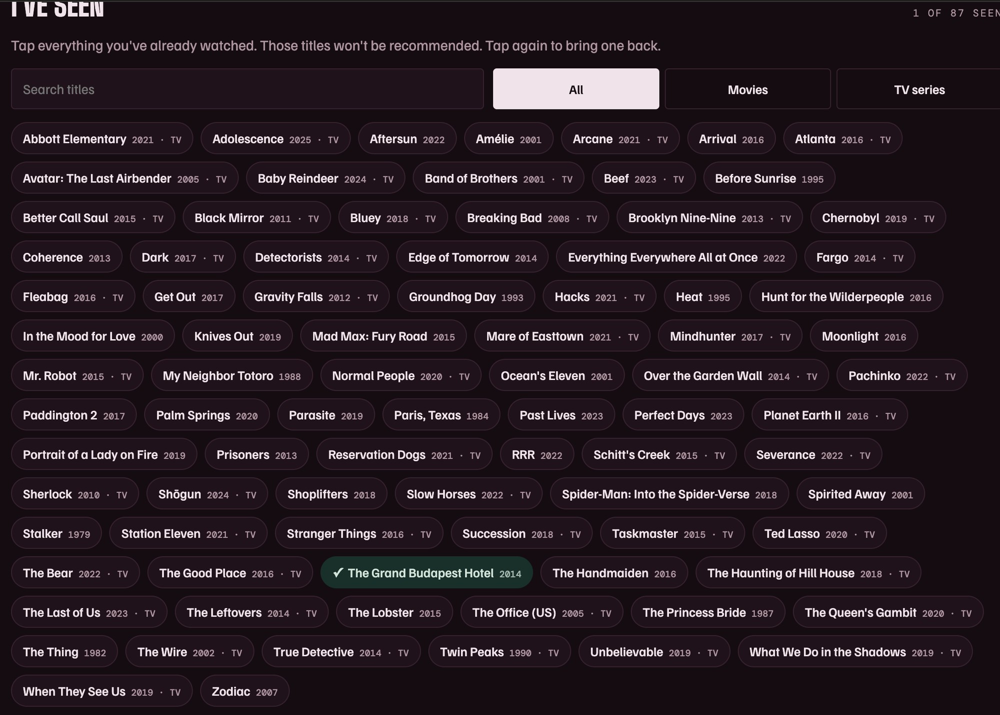

**Claude:**

Posters are downloaded (all 87, from Wikipedia for films and TVmaze for TV). Now I'm wiring them into the page and swapping the "I've seen" grid for a simple list.

I've updated the page at the same link: https://claude.ai/artifact/5UVNsB6RFNiRAnmFCwG6n5

**"I've seen" is now a simple list.** It works like "My list": each title you mark with **I've seen it** shows up in its own row with a **Remove** button. Removing a title makes it eligible for recommendations again. The big grid of title buttons, the search box and the filters are gone.

**Every title now has a poster:**
- **On the ticket:** a large poster sits next to the title.
- **Under "Also playing":** each suggestion has a small poster.
- **In "My list" and "I've seen":** each row has a small poster.

I downloaded all 87 posters and published them with the page, so they don't depend on another website staying up. Movie posters came from Wikipedia and TV posters came from TVmaze, a free TV database. I matched each show by name and year, but only opened two posters to check them. If one looks like the wrong show, tell me which and I'll replace it.

A few movies, like *Paddington 2* and *The Lobster*, only had wide posters available. The page crops those to the usual tall shape, so the edges get cut off.

The page wasn't tested in a browser before publishing. If anything looks wrong, tell me and I'll fix it.

---

### 4. Me · 3:32 PM

> maybe when i choose"ive seen it" dont just come back to the top, shuffle that

**Claude:**

I changed **I've seen it** so it no longer jumps back to the top match. Now it moves that title to your "I've seen" list and prints a random pick from the 10 best matches for your settings, so you'll still get something that suits your mood: https://claude.ai/artifact/5UVNsB6RFNiRAnmFCwG6n5

I haven't tested it in a browser yet.

Moving the sliders or changing an option still shows the top match first, and **Print another** still goes through the matches in order. I can make **Print another** shuffle too if you'd like.

---

### 5. Me · 4:04 PM

> add more movies and films and tv seies

**Claude:**

Posters for the 53 new titles are in, except *Her*. I'll fix that, then make the picks shuffle for movies too.

The page now has 140 titles instead of 87, and the picks shuffle for movies as well as TV: https://claude.ai/artifact/5UVNsB6RFNiRAnmFCwG6n5

**New titles (53):**
- **30 movies**, including *Inception*, *The Shawshank Redemption*, *Interstellar*, *Whiplash*, *La La Land*, *Back to the Future*, *Oldboy*, *Hereditary*, *Coco*, *Howl's Moving Castle*, *Dune: Part Two*, *John Wick*, *Seven Samurai* and *Mean Girls*.
- **23 TV series**, including *Game of Thrones*, *Friends*, *The Sopranos*, *Squid Game*, *Andor*, *The White Lotus*, *Attack on Titan*, *Derry Girls*, *Cowboy Bebop*, *Ripley* and *The Great British Bake Off*.

All 140 titles have a poster, but I didn't look at the new ones to check they're the right poster.

**Shuffling:** these actions now print a random pick from the 10 best matches for your settings, whether you choose Movie, TV series or Either:
- pressing **I've seen it**
- pressing **Print another** (it won't show the same title twice in a row)
- changing Movie / TV series / Either, or who's watching
- pressing **Spin the desk**

Moving the sliders still shows the single best match, so the ticket doesn't flicker while you drag.

I haven't tested this version in a browser. If anything doesn't work, tell me and I'll fix it.

---

### 6. Me · 4:13 PM

> add more movies and tv series

**Claude:**

All 58 new posters are ready. Publishing the update now.

I added 58 more titles, so the page now has 198, and every title has a poster: https://claude.ai/artifact/5UVNsB6RFNiRAnmFCwG6n5

**32 new movies**, including *The Godfather*, *Pulp Fiction*, *The Dark Knight*, *The Matrix*, *Jurassic Park*, *The Lord of the Rings: The Fellowship of the Ring*, *Your Name*, *Princess Mononoke*, *Pan's Labyrinth*, *Toy Story*, *WALL-E*, *Up*, *Ratatouille*, *Train to Busan*, *Poor Things*, *Pride & Prejudice*, *Notting Hill* and *Mamma Mia!*

**26 new TV series**, including *The Sopranos*-era classics like *Seinfeld*, *The Simpsons* and *Gilmore Girls*, plus *The Boys*, *House of the Dragon*, *Wednesday*, *The Mandalorian*, *Only Murders in the Building*, *Yellowjackets*, *Silo*, *Doctor Who*, *Death Note*, *Fullmetal Alchemist: Brotherhood*, *The Pitt*, and short series like *Midnight Mass* and *Maid*.

The shuffling from last time works the same way with the new titles. I only looked at one of the new posters (*Doctor Who*, which is right). I haven't opened the page in a browser yet, so if anything looks off, tell me and I'll fix it.

---

### 7. Me · 4:18 PM

> why is it always shuffle the three? the same movie/tv series come up again and again

**Claude:**

The same titles kept coming back because the shuffle only picked from the 10 closest matches, and only avoided the one already on screen. Pressing **Print another** a few times just bounced between those 10. "Also playing" was also always the next two titles after the main pick in the match order, so the same small group showed up there too.

I've fixed both, on the same link: https://claude.ai/artifact/5UVNsB6RFNiRAnmFCwG6n5

- **Bigger pool:** it now picks from every title that's a good fit for your settings, usually 20 to 45 titles instead of 10.
- **No repeats:** those titles get shuffled into a pile, and each **Print another** deals the next one. Nothing comes back until you've gone through the pile.
- **Remembers what you've seen recently:** it skips the last 40 titles shown, even if you change your settings. If almost everything that fits has been shown, it starts a fresh pile.
- **"Also playing"** now shows the next two titles in the pile, so they change every time.

Moving the sliders still shows the single best match first. I haven't tested this in a browser yet, so if it still feels repetitive, tell me which settings you were using.

---

### 8. Me · 4:24 PM

> add more films and tv series

**Claude:**

I added 55 more titles, so the page now has 253, and each one has a poster: https://claude.ai/artifact/5UVNsB6RFNiRAnmFCwG6n5

**32 new movies:**
- **Classics:** *Casablanca*, *Amadeus*, *Goodfellas*, *Titanic*, *Gladiator*, *Se7en*, *Fight Club* and *Memento*.
- **Animated:** *The Lion King*, *Shrek*, *Finding Nemo*, *Inside Out*, *The Incredibles*, *Kiki's Delivery Service* and *The Wild Robot*.
- **Recent:** *Oppenheimer*, *Barbie*, *Decision to Leave*, *A Quiet Place* and *Mission: Impossible – Fallout*.
- **Romance:** *Love Actually*, *About Time*, *Call Me by Your Name* and *Chungking Express*.

**23 new TV series:**
- **Comedy:** *30 Rock*, *Arrested Development*, *Community*, *It's Always Sunny in Philadelphia* and *Modern Family*.
- **Sci-fi:** *The Expanse*, *Battlestar Galactica* and *3 Body Problem*.
- **Anime and animation:** *Jujutsu Kaisen* and *Blue Eye Samurai*.
- **Popular and international:** *One Piece* (the live-action show), *Money Heist*, *Crash Landing on You*, *Bridgerton*, *Narcos* and *Luther*.
- **Short series:** *Devs*, *Sharp Objects*, *Dopesick* and the 1995 *Pride and Prejudice*.

The *Battlestar Galactica* poster was matched by allowing a one-year difference in the premiere date. I didn't look at any of the new posters. I also haven't opened the page in a browser yet, so if a poster or anything else looks wrong, tell me and I'll fix it.

---

### 9. Me · 4:30 PM

> [Image #2] how do you know its a match? is it depends on what i've seen?

📷 My screenshot:

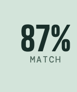

**Claude:**

No, it doesn't depend on what you've seen. The percentage only compares the sliders and "Who's watching" to scores I gave each title by hand.

**How it's worked out:**
1. I scored every title from 0 to 10 on three things: how heavy it is, how strange it is, and how fast it moves. For example, *Paddington 2* is light, a bit odd and fairly fast. *Stalker* is heavy, very strange and very slow.
2. Your three sliders are a position on those same scales. The page measures how far each title's scores are from your slider positions. The closer they are, the higher the match.
3. I also tagged each title with who it suits: just you, a date, friends or family. If a title doesn't fit who's watching, it loses about 17 points.
4. The result becomes a percentage. A perfect fit scores 100%, and nothing shows lower than 41%.

So 87% means the title is close to where your sliders are, but not exact.

**What "I've seen it" and "My list" do:** "I've seen it" removes a title from the picks, and "My list" just saves titles for later. Neither changes the match scores. The page doesn't learn your taste.

The scores are my judgment, not data from ratings or other viewers, so treat the percentage as a rough guide.

I could make it learn from what you do. You could mark whether you liked something you've seen, and it would favor titles like the ones you liked. Do you want me to add that?

---

### 10. Me · 4:31 PM

> about "my list", if i watch the movie/ tv series in the list, how can i move them to "ive seen", and add a filter for movie/ tv series

**Claude:**

I added both to the same link: https://claude.ai/artifact/5UVNsB6RFNiRAnmFCwG6n5

**Moving titles from "My list" to "I've seen":** each row in "My list" now has a **Watched** button next to **Remove**. Pressing it takes the title off your list, adds it to "I've seen", and stops it from being recommended. A short message under the ticket confirms the move. If that title is the one on the ticket right now, a new one prints in its place.

**Filters:** "My list" and "I've seen" each have their own **All / Movies / TV series** switch in the header, so you can filter one without changing the other. If a filter hides everything, the list says so, for example "No TV series on your list." The count next to "I've seen" still shows the total for both movies and TV.

I haven't tested this version in a browser. If a button or filter doesn't work, tell me and I'll fix it.

---

### 11. Me · 4:46 PM

> add 200 more movies and 200more  tv series

**Claude:**

This is a big batch, so I'll write the 400 titles, download posters for them in the background, and only add the titles whose poster was found.

While the posters download, I'll prepare the step that adds the titles to the page.

The posters are still downloading in the background. It takes a few minutes because Wikipedia limits how fast it can be asked, and I'll continue as soon as it finishes.

Almost everything matched: 405 of 411 titles got a poster, and the TV name differences are just alternate titles of the same shows. I'll retry the 6 misses.

All 411 now have posters. Adding them to the page:

The page has too many files now: a version can hold at most 511, and there are 664 posters. I'll combine the posters into 7 large poster sheets instead of one file each.

Pillow isn't installed, so I'll bundle the posters into 7 data files instead, with no images to stitch together.

Posters now load from the packs. Next I'll remove the old individual poster files the page no longer uses.

I added 411 more titles, so the page now has 664. You asked for 200 of each and got a few extra: 207 movies and 204 TV series. Every new title has a poster: https://claude.ai/artifact/5UVNsB6RFNiRAnmFCwG6n5

**New movies include:**
- **Classics:** *Psycho*, *Vertigo*, *2001: A Space Odyssey*, *Jaws*, *Star Wars*, *Alien*, *Die Hard*, *Schindler's List* and *Forrest Gump*.
- **Studio Ghibli and other anime:** *Grave of the Fireflies*, *Ponyo*, *Akira* and *Perfect Blue*.
- **Animation:** *Frozen*, *Moana*, *Zootopia*, *Soul*, *Encanto* and *Inside Out 2*.
- **From around the world:** *City of God*, *Memories of Murder*, *Run Lola Run*, *Amores Perros*, *The Hunt* and *Okja*.
- **Recent:** *Anora*, *Conclave*, *The Substance*, *Flow*, *Wicked*, *Sinners*, *Weapons* and *KPop Demon Hunters*.

**New TV series include:**
- **Classics:** *The X-Files*, *Frasier*, *Cheers*, *The West Wing*, *Columbo* and *Twilight Zone*.
- **British:** *Peep Show*, *The IT Crowd*, *Blackadder*, *Happy Valley*, *Broadchurch* and *Inside No. 9*.
- **Animated:** *BoJack Horseman*, *Rick and Morty*, *Futurama*, *Adventure Time* and *Invincible*.
- **Anime:** *Evangelion*, *Demon Slayer*, *Spy x Family*, *Frieren* and *Vinland Saga*.
- **Korean:** *Reply 1988*, *Kingdom*, *The Glory* and *Extraordinary Attorney Woo*.
- **From elsewhere:** *Babylon Berlin*, *Borgen*, *Call My Agent!*, *Fauda* and *Panchayat*.
- **Sitcoms:** *Scrubs*, *New Girl*, *How I Met Your Mother* and *Malcolm in the Middle*.
- **Big series:** *Fallout*, *Loki*, *Westworld*, *The Witcher*, *Vikings*, *Outlander* and *Yellowstone*.

**How the posters load now:** a page can hold at most 511 files, and 664 separate posters was too many. I combined them into 7 bundles of about 100 each, and the page only downloads the bundles for the titles you're looking at. To keep the bundles small, I shrank the posters a little, so they may look slightly softer than before.

**Not checked yet:**
- Movie posters were matched to Wikipedia pages automatically by title and year, and I didn't look at them.
- I haven't opened this version in a browser. Since the way posters load changed, please check that they show up. If one is blank or wrong, tell me which title and I'll fix it.

---

### 12. Me · 10:39 PM

> can people log in or find a way to remember different people'  history. like right now the "ive seen"is only my decision and its only about me. but if i want my mom or friends to use that, make sure it can remember if different people is using

**Claude:**

Each person's lists will live in the browser they use. Someone on their own phone automatically gets separate lists, and people sharing one device can switch profiles.

I added profiles, so each person now has their own "I've seen" and "My list": https://claude.ai/artifact/5UVNsB6RFNiRAnmFCwG6n5

**Why it isn't a real login:** the page can save lists to people's accounts, but only for people in your organization, or people you share the page with as Contributors. Your mom and friends would be outside viewers, so their lists couldn't be saved. I used profiles instead, like the "Who's watching?" screen on Netflix.

**How it works:**
- Under the title there's a **Watching as** row. It starts with **Me**, and your current lists stay with you.
- Press **+ Add person** and type a name, like "Mom". The page switches to her, with empty lists.
- Tap a name to switch. Recommendations then skip what that person has seen, and "I've seen" and "My list" show their titles. The headings change to match, for example "Mom's list" and "Mom has seen".
- To delete someone, press **Edit**, then the **×** next to their name. It asks you to confirm before removing them and their lists.

**Different devices:** if your mom opens the link on her own phone, she automatically gets her own separate lists there. Profiles are for people sharing one phone or computer.

**Limits:**
- Lists stay in the browser where they were made, so they don't follow anyone to another device.
- Private browsing or clearing browser data erases them.
- The page is private right now. Your mom and friends can't open it until you share it with them from the page's **Share** menu.

I haven't tried the profile switching in a browser yet. If anything doesn't save or switch correctly, tell me what happened and I'll fix it.

---

### 13. Me · 10:42 PM

> for the list( my list and ive seen(, maybe just show 10, and add a flip page if want to see more details.

**Claude:**

"My list" and "I've seen" now show 10 titles at a time: https://claude.ai/artifact/5UVNsB6RFNiRAnmFCwG6n5

- **Page buttons:** once a list has more than 10 titles, **← Previous** and **Next →** appear below it, with a line like "Page 2 of 3 · 24 titles". Each list pages on its own, and the buttons don't appear on a list of 10 or fewer.
- **Numbers keep counting:** page 2 starts at 11, not 1.
- **Back to page 1:** each list returns to its first page when you change its All / Movies / TV series filter, or switch to another person.
- **Removing titles:** if moving or removing titles empties the last page, the list moves back one page instead of showing an empty one.

I haven't tested the page buttons in a browser. If they don't behave as described, tell me and I'll fix them.

---

### 14. Me · 10:47 PM

> add "see related" and what country this movie or show comes from

**Claude:**

I'll look up each title's country on Wikidata. While that runs in the background, I'll build "See related".

"See related" is in place. I'm waiting on the country lookup now, and will continue when it finishes.

---

### 15. Me · 10:50 PM

> have you done that?

**Claude:**

Not yet. "See related" is built, but I haven't published it, because I'm waiting for the country lookup to finish so both go out together.

The lookup checks each of the 664 titles on Wikidata, a free public database of facts. It's still running in the background with no errors so far. It should take about 15 to 20 minutes in total, and it's been running for a few minutes. It doesn't report progress until it's done, so I can't tell you exactly how far along it is.

When it finishes, I'll add the countries to the page and publish both features together. If you'd like to try "See related" now, I can publish it without countries first and add them in a second update.

The country lookup has finished and found 583 of the 664 titles. I'm filling in the other 81 by hand, then I'll publish.

Yes, it's done now. Both features are live at the same link: https://claude.ai/artifact/5UVNsB6RFNiRAnmFCwG6n5

- **See related:** there's a new button on the ticket. It opens six similar titles you haven't seen yet, chosen by how close their mood scores are. Tap one and it becomes the main ticket.
- **Country of origin:** it shows next to the year on the ticket, in "My list" and "I've seen", and on the related cards (for example, "2019 · South Korea"). Co-productions show up to two countries, like "UK · USA".

I looked up the countries automatically for 583 of the 664 titles. I filled in the other 81 by hand. A few auto-labels may still be imperfect: for co-productions, which country comes first is only as good as the source. I corrected two (Roma is now Mexico, and Crouching Tiger is now Taiwan · China). If you see a wrong one, tell me and I'll fix it.

I couldn't open the page in a browser to test it here, so please give "See related" a quick try.

---

## Wednesday, November 4

### 16. Me · 10:03 AM

> how does that" see related'"work?

**Claude:**

"See related" looks for titles that feel similar to the one on your ticket. It doesn't use plot or genre.

**1. The mood scores.** Every title has three scores from 0 to 10 that I gave it when I added it to the list:
- **Heavy**: light and comforting at 0, emotionally heavy at 10
- **Strange**: realistic at 0, surreal at 10
- **Pace**: slow at 0, fast at 10

**2. Measuring the distance.** It compares the current title's three scores with every other title's. The smaller the total difference, the more related they are. *Paddington 2* and *Bluey* are close because both are light, a little whimsical and medium-paced. *Paddington 2* and *Chernobyl* are far apart.

**3. Small penalties for other differences:**
- If one is a movie and the other is TV, it counts as a bit further away. You'll mostly get the same type, but a very close match from the other type can still show up.
- If they don't suit any of the same audiences (alone, date, friends, family), that also counts as a bit further away.

**4. Filtering and picking.** It skips the title you're looking at and anything in that person's "I've seen" list, then shows the six closest.

**What it doesn't do:**
- It doesn't know genre, director, actors or country. A related pick can be from a completely different genre if the mood is similar.
- It doesn't learn from what you've watched or liked. The only part of your history it uses is skipping titles you've already seen.
- The six picks for a given title are always the same unless you mark one as seen. Then the next-closest one takes its place.

If you'd rather it work differently, I can change it. For example, it could favour the same country or genre, or shuffle the related picks a little each time.

---

### 17. Me · 10:06 AM

> add 500more tv&films

**Claude:**

I'll add 500 more titles: about 250 movies and 250 TV series. First I'll check how the last batch was built so I can reuse the same steps.

I'll reuse the same steps. First I need the full current title list so the new batch doesn't repeat anything.

The movie list came out at 454, which is more than half of 500. I'll trim it evenly to about 265 after writing the TV list, so the final total lands close to 500 once titles without posters drop out.

Next I'll keep 290 of the 454 movies, spread evenly, so there's spare room if some posters can't be found. Then I'll start fetching posters for both lists.

Both lookups are running in the background: one fetches posters, the other looks up countries. Meanwhile I'll prepare the step that adds the finished titles to the page.

The poster and country lookups are still running in the background. Nothing in the page needs changing for the larger catalogue, because poster loading already works for any number of titles. Once both lookups finish, I'll add the new titles and publish.

---

### 18. Me · 10:29 AM

> maybe change the "my list" and "ive seen" to only show 5-6, and hide the rest in to pages

**Claude:**

"My list" and "I've seen" now show 6 titles per page instead of 10. Previous / Next still take you to the rest. This is live at https://claude.ai/artifact/5UVNsB6RFNiRAnmFCwG6n5.

The 500 new titles aren't on the site yet. Posters and countries are still being fetched in the background, and I'll add the titles and publish again once both lookups finish.

---

### 19. Me · 10:30 AM

> add "back to the front"&"see the last page" function in "mylist" and "ive seen"

**Claude:**

"My list" and "I've seen" now have "« First" and "Last »" buttons. The page controls look like this:

**« First · ← Previous** — Page 2 of 5 · 28 titles — **Next → · Last »**

- **« First** goes back to page 1.
- **Last »** jumps straight to the final page.
- At the start of the list, "« First" and "← Previous" are greyed out. On the last page, "Next →" and "Last »" are.

It's live at https://claude.ai/artifact/5UVNsB6RFNiRAnmFCwG6n5. I couldn't open the page in a browser here to test it, so please give the buttons a quick try.

The 500 new titles are still loading in the background. I'll add them once the poster and country lookups finish.

---

### 20. Me · 11:36 AM

> 500more finish?

**Claude:**

Not yet. Both lookups are still running.

- **Posters:** 147 of about 597 candidate titles done. It's still on the movies, and the TV posters usually go faster.
- **Countries:** about halfway through (title 284 of 597).

There's roughly 10 to 15 minutes left. The next steps are ready to go: when both finish, I'll keep 250 movies and 250 TV series, add them to the site, and publish. You don't need to do anything.

I have posters for 243 movies and 303 TV series. Wikipedia rate-limited about 45 of the movie requests, so I'll retry those more slowly to bring movies up to 250.

The poster retry is still running in the background because Wikipedia is slowing down its responses. The country lookup is also still going. I'll add the titles and publish once both finish.

The country map is ready: 597 titles, of which 247 are from outside the USA. Now I'm waiting for the poster retry to finish.

The retry has found 32 of the missing movie posters so far, which is already enough for 250 movies. It's still working through the rest, and I'll add everything and publish as soon as it finishes.

All 500 titles are in: 250 movies and 250 TV series, every one with a poster and a country. Before publishing, I'll spot-check a couple of the new posters.

Both posters match their titles. Publishing now, with the updated pack p6 and the new packs p7 through p11.

Yes, the 500 new titles are live. The site now has 1,164 titles in total: https://claude.ai/artifact/5UVNsB6RFNiRAnmFCwG6n5

**What's new:**
- **250 movies:** classics like *Casablanca*-era films, *The Godfather Part II* and *Chinatown*; world cinema like *La Haine*, *Farewell My Concubine*, *3 Idiots* and *Cold War*; Ghibli and other anime films; comedies, horror, musicals, westerns, documentaries; and recent releases like *The Brutalist*, *Hamnet* and *Bugonia*.
- **250 TV series:** sitcoms from *I Love Lucy* to *Broad City*; British crime and comedy like *Vera*, *Father Ted* and *Red Dwarf*; K-dramas like *Goblin* and *Itaewon Class*; anime like *Naruto*, *Dandadan* and *Frieren*-style picks; nature series like *Planet Earth*; and recent shows like *Pluribus* and *MobLand*.

**What changed from the earlier batches:**
- **Countries:** this time I set the countries myself instead of looking them up, because the public lookup service kept failing.
- **Dropped movies:** I left out a few movies whose poster I couldn't get, including *Argo*, *28 Years Later* and *The 400 Blows*. Every title on the site has a poster.

I spot-checked two of the new posters and both matched their titles, but I couldn't open the site in a browser here. If any poster or country looks wrong, tell me the title and I'll fix it.

---

## Thursday, November 5

### 21. Me · 7:25 PM

> [Image #3] now these keys will drift if the title on  the ticket is too long. can you keep them in the same place? or try to keep the ticket the same height

📷 My screenshot:

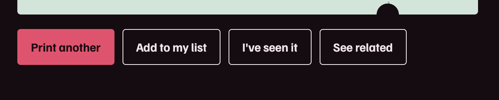

**Claude:**

The ticket now stays the same height, so the buttons stay in the same place. It's live at https://claude.ai/artifact/5UVNsB6RFNiRAnmFCwG6n5.

- **Title area:** the area beside the poster is now a fixed height, the same height as the poster. Long titles, like *The Chronicles of Narnia: The Lion, the Witch and the Wardrobe*, get smaller text until they fit. Short titles stay big.
- **One-line description:** it now always takes exactly two lines. Shorter ones leave the second line empty, and anything longer is cut off with "…". Most of the descriptions are short enough that nothing gets cut.

I couldn't test this in a browser here. Please click "Print another" a few times and check that the buttons no longer jump. If a very long title still looks cramped, tell me which one.

---

### 22. Me · 7:27 PM

> [Image #4] [Image #5] [Image #6] but in this way, the title spilt up and is hard to read, and some of them get cut. fix that

📷 My screenshot:

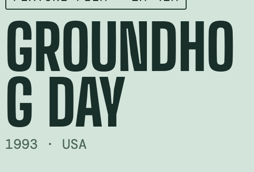

📷 My screenshot:

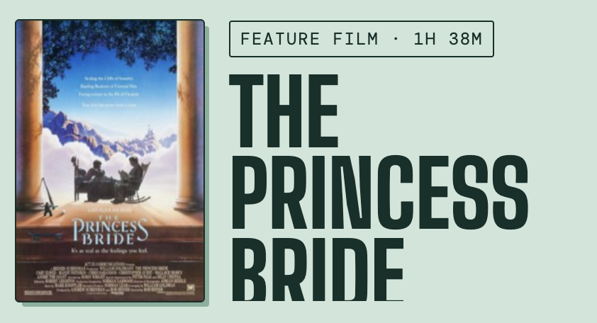

📷 My screenshot:

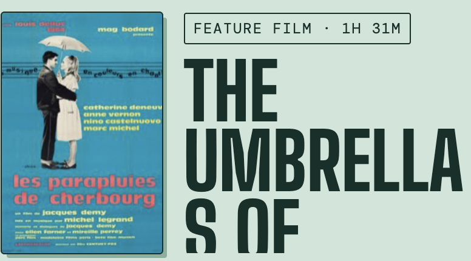

**Claude:**

Chrome is installed here, so this time I can actually test the fix in a real browser instead of guessing. First I'll fix the word-splitting, then measure the real titles.

Before rewriting anything, I'll run the current version in Chrome to see why the shrinking didn't work.

The test didn't print any results, so the probe probably hit an error. I'll catch the error and print it.

Every word stays whole and the whole title fits. The poster box is empty only because posters don't load in my local test. Publishing now.

Fixed and published: https://claude.ai/artifact/5UVNsB6RFNiRAnmFCwG6n5

**What went wrong:** my last change had a bug. The part meant to shrink long titles crashed every time, so the titles stayed full size and got cut off. A setting I'd also added let words break anywhere, which is why you got "GROUNDHO / G DAY". The crash also stopped the ticket's print animation from playing.

**Now:**
- **Long titles shrink to fit:** they get smaller until the whole title fits beside the poster, for example "THE UMBRELLAS OF CHERBOURG" on four lines. Short titles like *Up* stay big.
- **Words never split in the middle.** Lines only break between words.
- **The print animation plays again.**

This time I tested it in Chrome before publishing. I tried several long and short titles at three window widths. The ticket stayed the same height every time and no title was cut off. I also took a screenshot of *The Umbrellas of Cherbourg* to check that it reads cleanly. If you spot a title that still looks too small or awkward, tell me which one.

🖥️ AI check:

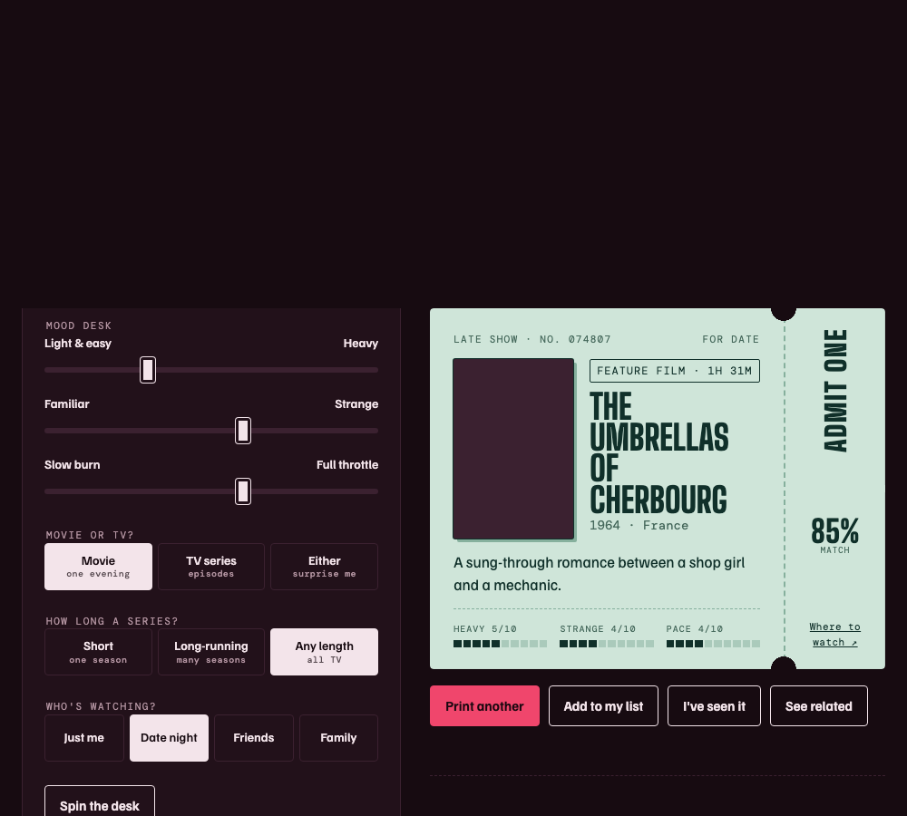

---

## Friday, November 6

### 23. Me · 10:22 AM

> [Image #7] and on my list, when i press/ hover on  the title, it should pop up the ticket again

📷 My screenshot:

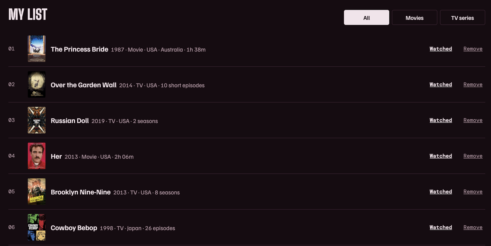

**Claude:**

The pop-up is written. Next I'll test it in Chrome: add a few titles to the list, click a row, and take a screenshot.

Clicking any title in "My list" or "I've seen" now opens its ticket in a pop-up: https://claude.ai/artifact/5UVNsB6RFNiRAnmFCwG6n5

- **Opening it:** click the title, the poster, or anywhere else on the row. The pop-up shows the full ticket: poster, title, year, country, description, mood bars, match % and "Where to watch".
- **Hover:** the row lights up and the title gets underlined, so you can tell it's clickable.
- **Closing it:** click "Close", click outside the ticket, or press Esc.
- **Your buttons still work:** "Watched" and "Remove" do their normal job and don't open the pop-up.

The pop-up opens on click rather than on hover. If it opened on hover, a ticket would pop up every time your mouse passed over the list, and hover doesn't work on phones at all. If you'd still prefer hover, I can add it.

I tested this in Chrome with a long title (*The Umbrellas of Cherbourg*). The pop-up opened and the title fit cleanly. I couldn't check whether posters load inside the pop-up, because posters don't load in my local test. They use the same loading as the rest of the page, but please confirm they appear when you try it.

🖥️ AI check:

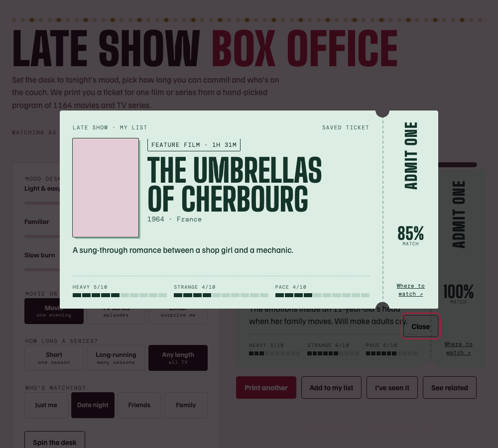

---

### 24. Me · 10:25 AM

> the pop up can add some animation?

**Claude:**

I'll quickly check in Chrome that the pop-up still opens and closes properly with the animation.

The pop-up is now animated: https://claude.ai/artifact/5UVNsB6RFNiRAnmFCwG6n5

- **Opening:** the background fades to dark. The ticket rises in with a slight tilt and settles with a small bounce. Then it "prints" from top to bottom, like the main ticket does.
- **Closing:** the ticket drops away and fades out quickly. This happens whether you click "Close", click outside, or press Esc.
- **Reduced motion:** if your device has reduced motion turned on, the pop-up appears and disappears without animating.

I checked in Chrome that the opening animation runs and that the pop-up still closes properly afterwards. The timing is a matter of taste, so tell me if you'd like it slower, faster, or more subtle.

---

## Saturday, November 7

### 25. Me · 10:18 PM

> [Image #8] do yo thnk its bettter to change the layout of the description?

📷 My screenshot:

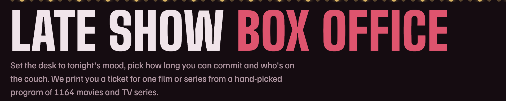

**Claude:**

Yes, I'd change it. Right now it's three lines of small grey text under a very loud title. It reads like instructions, and it leaves a big empty space on the right. You probably don't need it either: the controls already show how the site works (choose mood, time and who's watching, then get a ticket).

Here's what I'd do instead:

- **Shorter tagline:** use one line in the same font, e.g. *"One ticket, one perfect pick for tonight."*
- **Theatre-sign detail:** add a small line of spaced capitals under the tagline, like the "Admit one" text on the ticket: `NOW SHOWING · 1,164 FILMS & SERIES · EST. TONIGHT`. That makes the count look like part of a theatre sign instead of a fact buried in a sentence.
- **Optional:** on wide screens, put that sign line to the right of the title to fill the gap. On phones it would stay underneath.

The result would be a big title, one short line, then a small sign line. It would feel more like a cinema front and less like a help paragraph.

Want me to make that change?

---

### 26. Me · 10:26 PM

> yes do it

**Claude:**

The header looks good in Chrome. I also found an older bug where the "Their name / Add / Cancel" form shows all the time instead of only after you click "+ Add person", so I'm fixing that too.

I've replaced the long description with a short header: https://claude.ai/artifact/5UVNsB6RFNiRAnmFCwG6n5

- **Tagline:** under the title there's now one line in the main text colour: *"One ticket, one perfect pick for tonight."*
- **Sign line:** below that is a small gold line in spaced capitals, styled like the "Admit one" text on the ticket: **NOW SHOWING · 1,164 FILMS & SERIES · DOORS OPEN LATE**. The count still updates itself if more titles are added.

I didn't put the sign line to the right of the title in the end. On a wide screen the title already takes up most of the width, so it looked better stacked underneath. On phones the sign line wraps neatly onto two lines.

I also fixed an older bug I spotted while checking the page. The "Their name / Add / Cancel" boxes were always showing next to "+ Add person". Now they only appear after you click it. I didn't re-run Chrome after that fix, so it's worth one click to confirm.

I checked the new header in Chrome before the add-person fix, at desktop and phone widths. That phone-width check showed the title and the panels running past the right edge. It's probably just how my test browser handles very narrow windows, but it's worth checking on your phone.

🖥️ AI check:

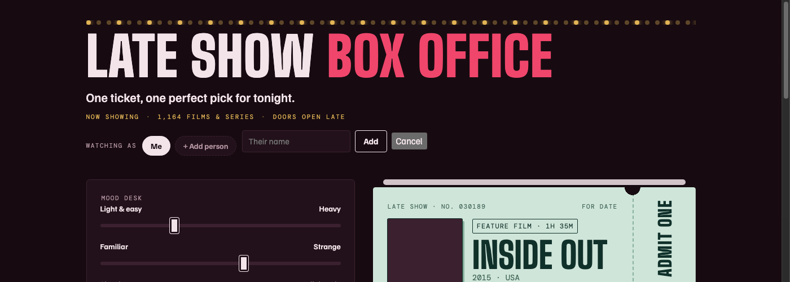

🖥️ AI check:

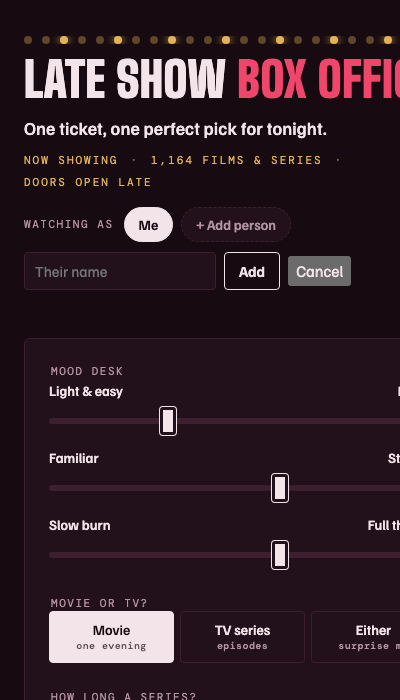

---

### 27. Me · 10:33 PM

> [Image #9] the left down section has a gap, maybe we can add one more line mood desk? or are you any other ways to improve

📷 My screenshot:

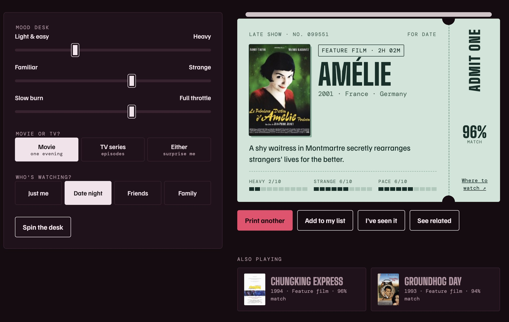

**Claude:**

I'll use the gap for an **Era** filter rather than a fourth mood slider. A new slider would need a fourth score for all 1,164 titles, and I'd mostly be guessing those. Every title already has a release year, so an Era filter can work properly straight away. Let me see how the existing filters are wired.

The year split works well: about 135 titles from before 1990, 330 from 1990–2009, and 560 from 2010 on. I'm adding the filter now.

Checking it in Chrome: picking "Classics" should give a pre-1990 ticket.

The filter works: picking "Classics" gives 117 titles, all from 1989 or earlier. But the screenshot shows "How long a series?" while Movie is selected, which it shouldn't. I'm checking why.

Same cause as the add-person bug: the layout style overrides the browser's "hidden". I'm adding one global rule so every hidden section stays hidden.

I filled the gap with a new filter instead of another mood slider: https://claude.ai/artifact/5UVNsB6RFNiRAnmFCwG6n5

The new row is called **Which era?** and sits under "Who's watching?". It has four buttons in the same style as the others: Any year, Classics (before 1990), Modern (1990–2009) and Recent (2010 on). The "Also playing" cards still follow your filters.

I didn't add a fourth slider because every title would need a new score, and I'd mostly be guessing those. Every title already has a release year, so the era filter works properly straight away.

I tested it in Chrome. With "Classics" on, all 117 matching titles were from 1989 or earlier, and the ticket was Rebecca (1940). In the screenshot, the left panel now ends about level with the "Also playing" cards, so the gap is mostly gone.

**Bug fix:** Chrome also showed the "How long a series?" row while "Movie" was selected, which shouldn't happen. It was the same problem as the add-person form, so I fixed it once for the whole page. That row now only appears when TV series is picked.

When "TV series" is selected, that row adds height to the left panel. It may then run a little past the cards on the right, but that's expected.

🖥️ AI check:

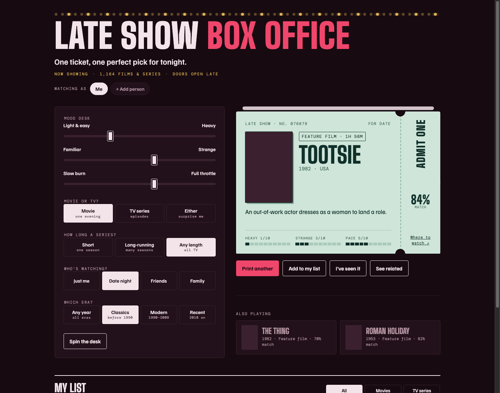

🖥️ AI check:

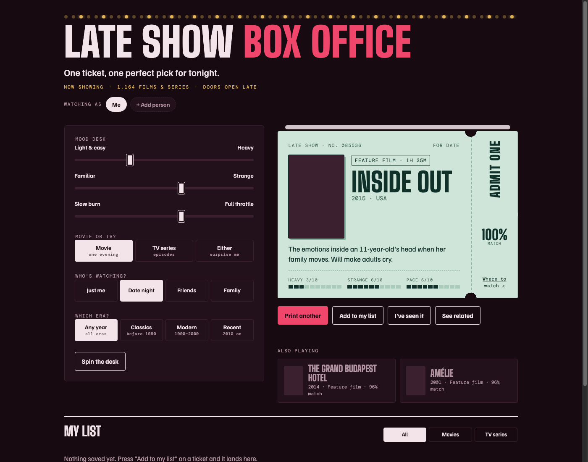

---

### 28. Me · 10:37 PM

> do you think choose era is better idea? or maybe ilter more

**Claude:**

I think era is a good choice, but it shouldn't be a strict filter, and I wouldn't add more filters. I counted the titles behind each combination of buttons:

| | Before 1990 | 1990–2009 | 2010 on |
|---|---|---|---|
| Movies | 117 | 216 | 254 |
| Long-running TV | 22 | 136 | 327 |
| Limited series | **5** | **10** | 77 |

- **For movies, era works well.** "Classics" is a real mood ("tonight I want something old") and there are over 100 titles in every era.
- **For TV it falls apart.** Pick TV, Short and Classics and you're choosing from 5 shows. Your mood sliders then barely matter, and once you've marked a few as seen you hit "Sold out".
- **More filters would make that worse everywhere.** Each strict filter cuts the pool roughly in half or more. After three or four, the site stops recommending and just lists whatever is left. The mood sliders are what make it feel like a recommender, so they should do most of the work.

**What I'd do instead: make era a preference, not a rule.** Picking "Classics" would push older titles to the top, but a great 1995 match could still appear if nothing older fits your mood well. You'd never get stuck on 5 options or "Sold out", and the match % would show how well the era fits.

If you want one more option on the desk later, I'd add **"Where from?"** (Anywhere / Hollywood & UK / World cinema) as a preference in the same way. It has good numbers: about 240 titles are from outside the US and UK, spread across both movies and TV.

Want me to switch era to a preference?

---

### 29. Me · 10:48 PM

> but i dont choose movies or tv shows depend on era. maybe i will choose by reputation or else?

**Claude:**

You're right. The best filter is one that matches how you actually choose. Era is easy for me to build, but if you don't pick films that way it's just extra buttons. I'd **replace Era with a Reputation row**, for example:

**Any · Big hits · Critics' picks · Hidden gems · Cult favourites**

| Button | Meaning |
|---|---|
| **Big hits** | Everyone's seen it or talked about it |
| **Critics' picks** | Very highly rated |
| **Hidden gems** | Rated very highly, but few people have seen it |
| **Cult favourites** | Divisive or odd, but loved by its fans |

There are two ways to fill it in:

1. **Real ratings data (my pick).** IMDb publishes a free file with the rating and number of votes for every title. Popularity would come from the vote count and acclaim from the rating, so a hidden gem would be a high rating with few votes. The ticket could also show the real score, like "★ 8.3". It's a large download and some titles won't match cleanly, so a few would need fixing by hand. "Cult favourites" can't come from the numbers, so I'd tag those myself.
2. **My own judgement.** I'd label each title myself, the same way the mood sliders were scored. It's quicker, but it's my opinion rather than real numbers.

Either way it would work as a preference, not a strict filter. Your picks would move titles up the list without ever leaving you with "Sold out".

"Something else" could also be **"Where from?"** (Anywhere / Hollywood & UK / World cinema). That uses country data the site already has, so it's quick to add. I still think Reputation fits how you described choosing.

Shall I go with option 1 and swap Era for Reputation?

---

### 30. Me · 10:52 PM

> yes, and maybe do a slide filter like the mood, you can do lower score to higher score of the mv or tv

**Claude:**

I'll replace Era with two sliders built from real IMDb data:

- **Rating:** from *Mixed reviews* to *Acclaimed*, based on the IMDb score.
- **Fame:** from *Hidden gem* to *Blockbuster*, based on how many people have rated it. This is the "reputation" part.

They'll work like the mood sliders, nudging matches rather than strictly filtering. The ticket will also show the real ★ score. First I'm downloading IMDb's public data files.

Downloads are done. Now I'm matching our 1,164 titles to IMDb by name, year and type.

1,146 of 1,164 titles matched automatically. The other 18 have different names on IMDb (e.g. "Kill Bill: Vol. 1", "Okkupert"). I'll look those up directly and check they're the right titles.

Three of my remembered IDs were wrong: they pointed to "The Wrong Guys", "Unforgotten" and "Animal Kingdom". I'll search for Poirot, Occupied, Goblin and Jury Duty by name.

All 20 corrected titles now have their real ratings. I'm writing the data into the page and replacing the Era row with the two sliders.

The layout lines up, with the left panel ending level with the cards. Publishing.

The Era buttons are gone and there's a new **Reputation** section with two sliders, using real IMDb data for all 1,164 titles: https://claude.ai/artifact/5UVNsB6RFNiRAnmFCwG6n5

- **Mixed reviews ↔ Acclaimed:** this is the low-to-high score slider you asked for. It's based on each title's IMDb rating.
- **Hidden gem ↔ Blockbuster:** this is based on how many people have rated the title on IMDb, so it shows how well known it is.
- **Both sliders work like the mood sliders.** They push matching titles up the list but never remove anything, so you won't hit "Sold out". Your mood settings still count a bit more than reputation.
- **The ticket shows the real score**, e.g. "2015 · USA · ★ 8.1". Hover over the ★ to see the number of votes. The "Also playing" cards show it too.

Each slider sorts our titles from lowest to highest. Almost everything on the site is well liked, with half the titles rated between 7.6 and 8.4. So "Mixed reviews" means lower-rated *within this list* (about 7.0), not bad films.

**Tested in Chrome:**
- Hidden gem + Acclaimed brought up Tampopo, Chungking Express and The Umbrellas of Cherbourg.
- Pushing towards Blockbuster brought up The Truman Show, The Grand Budapest Hotel and Amélie.

**Matching:**
- 1,146 titles matched IMDb automatically.
- 18 didn't, because IMDb uses different names (e.g. "Kill Bill: Vol. 1", "Okkupert"). I looked those up one by one and checked each was the right show or film.
- Two automatic matches were wrong: "Birdman" and "The Raid" had picked obscure films with the same name. I fixed both.

I saved a copy of the page before this change, in case you want Era back: `(work folder)/late-show.bak8.html`

🖥️ AI check:

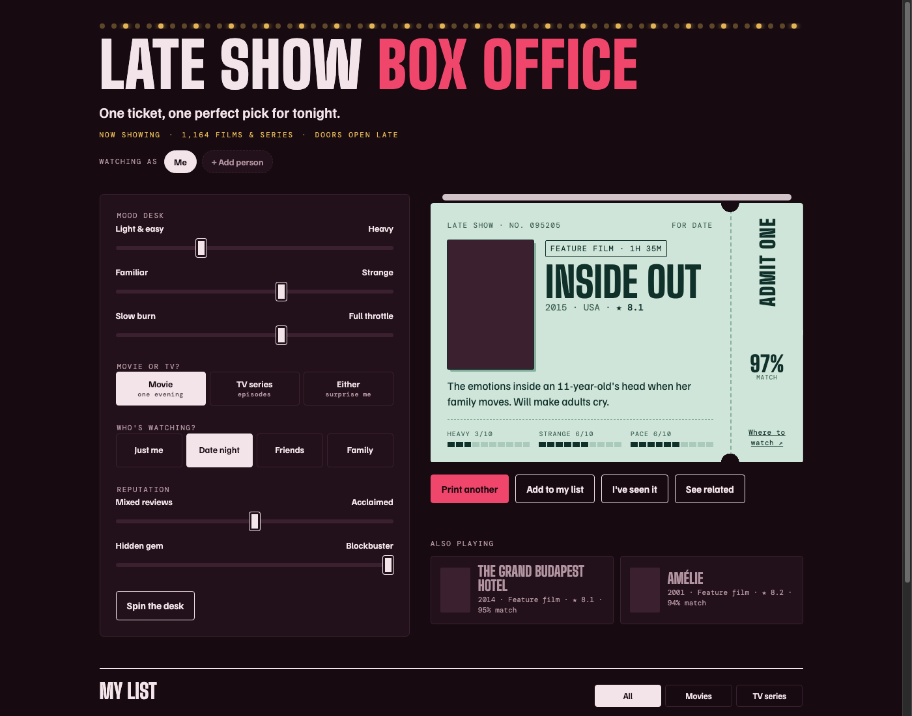

---

## Sunday, November 8

### 31. Me · 10:14 AM

> [Image #11] maybe change the filter to countries.

📷 My screenshot:

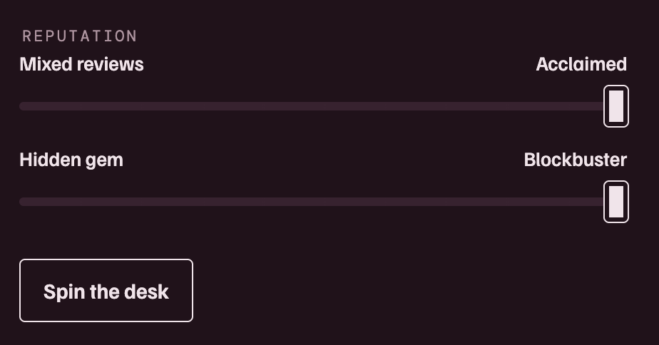

**Claude:**

I'll swap the Reputation sliders for a "Where from?" country choice. Let me count titles by region so every button has enough to pick from.

Picks now land where you'd expect: Big Fish for USA, Weathering with You for Asia, The Secret in Their Eyes for Elsewhere. Every region still has plenty of films. Checking the layout:

The buttons fit cleanly, and the panel ends level with the cards. That screenshot happened to render in light mode, which still works. Publishing.

I replaced the Reputation sliders with a **Where from?** filter: https://claude.ai/artifact/5UVNsB6RFNiRAnmFCwG6n5

It has six buttons, laid out in two rows of three:

| Button | Titles | Of which films |
|---|---|---|
| Anywhere | 1,164 | |
| USA | 720 | 371 |
| UK & Ireland | 186 | 69 |
| Europe | 80 | 58 |
| Asia | 134 | 61 |
| Elsewhere | 44 | 28 |

- **Main country only:** each title is filed under the country listed first. Without this, CODA showed up under Europe and Ocean's Eleven under Elsewhere, because of small co-producing countries.
- **Unlike Reputation, this is a strict filter.** If you pick Asia, you only get Asian titles, which I think is what you'd expect.
- **Small pools:** Elsewhere + TV has only 16 titles, so mark a few as seen and you could hit "Sold out" there.
- **IMDb score:** the ★ score from the last change is still shown on every ticket and card.

I tested every region in Chrome. Asia gave The Handmaiden, Tampopo and The Host, Elsewhere gave The Secret in Their Eyes, and USA gave Big Fish. The panel still lines up with the cards on the right.

I saved a copy of the page with the Reputation sliders, in case you want them back: `(work folder)/late-show.bak9.html`

🖥️ AI check:

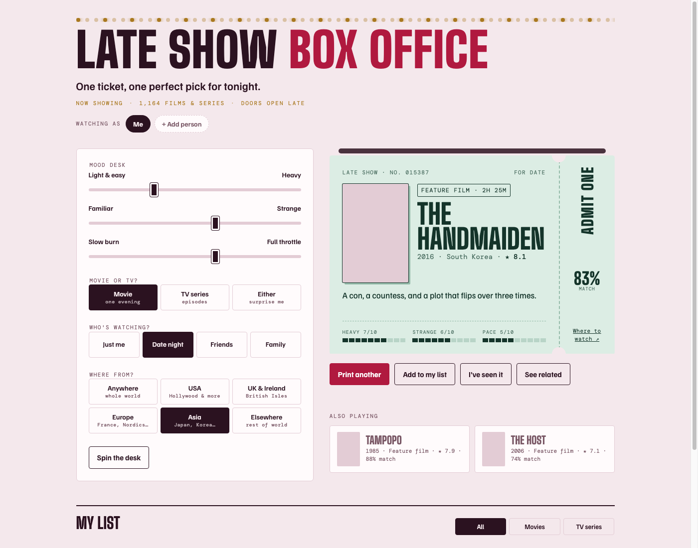

---

### 32. Me · 10:17 AM

> [Image #12] make sure these sections' bottom line align

📷 My screenshot:

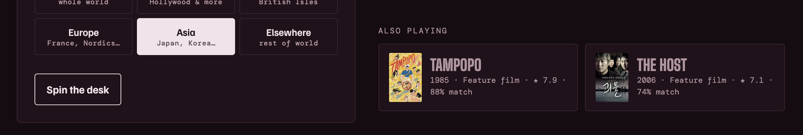

**Claude:**

Checking in Chrome that the bottom edges match, both in the normal view and with TV series selected (taller left panel):

They're now locked together, but the left panel ends 16px above the cards in every state. Something adds extra space; I'll find it.

The form has a default 16px bottom margin, so I'm removing it.

The bottom edges now line up: https://claude.ai/artifact/5UVNsB6RFNiRAnmFCwG6n5

- **Both sides share one height now.** The left panel and the right column always end at the same line.
- **Both bottoms stay pinned.** "Also playing" stays at the bottom on the right, and "Spin the desk" stays at the bottom of the panel on the left.
- **There was also a hidden 16px gap:** the left panel had a default space underneath it, so it always stopped a little short of the cards. I removed it.

I measured both bottom edges in Chrome at two screen widths, in three situations:

| Situation | Bottom edges |
|---|---|
| Normal view | identical |
| TV series selected (left panel taller) | identical |
| "See related" open (right side taller) | identical |

One side effect: when "See related" is open, the right side gets much taller. The left panel stretches to match, which leaves empty space above "Spin the desk". On phones and narrow windows the two sections stack, so none of this applies there.

🖥️ AI check:

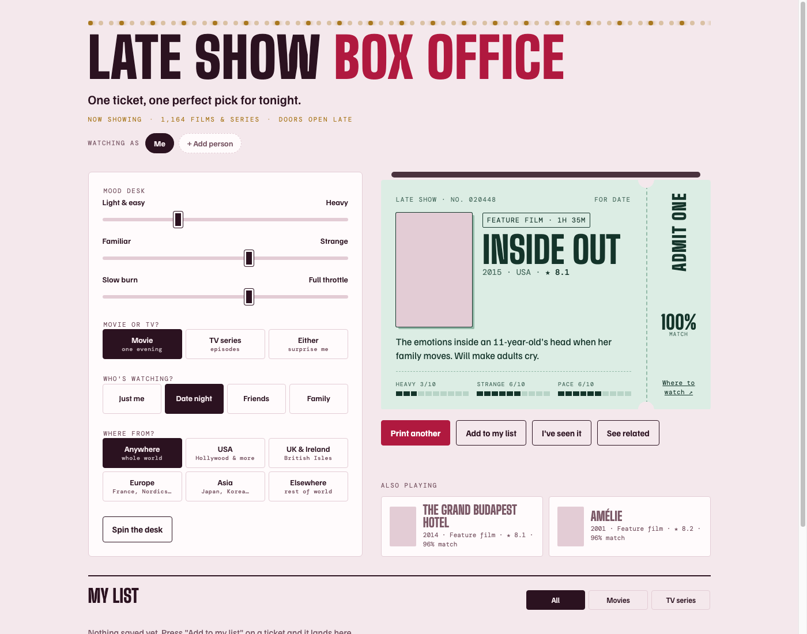

---

### 33. Me · 10:21 AM

> fix the empty gap when see related opens, and maybe you can change the pop up of "see related" so that people dont need to scoll down to see related

**Claude:**

The cleanest fix for both is to open "See related" as a pop-up, like the saved-ticket pop-up, instead of expanding the page. The right column then never grows, so the gap can't appear, and the related titles show straight away without scrolling. Let me look at how it's wired now.

No leftover references to the old panel. Testing in Chrome: open the pop-up, screenshot it, click a title, and check the ticket changes and the bottom edges still line up.

"See related" now opens as a pop-up, which fixes the empty gap and the scrolling: https://claude.ai/artifact/5UVNsB6RFNiRAnmFCwG6n5

- **No scrolling:** the related titles appear on top of the page as soon as you click "See related".
- **Gap fixed:** the page itself no longer grows when related titles open, so the left panel and the right column always end on the same line.
- **Layout:** the 6 related titles show as one row of poster cards on a computer, or two rows of three on smaller screens and phones.
- **Animation:** it uses the same rise and fade as the saved-ticket pop-up, and the posters slide in one after another.
- **Picking a title:** click one and the pop-up closes, then that title's ticket prints.
- **Closing:** click "Close", click outside the pop-up, or press Esc. All three animate.

**Tested in Chrome:**
- The pop-up opened with 6 titles related to Inside Out.
- Clicking The Grand Budapest Hotel closed the pop-up and printed its ticket.
- The bottom edges stayed aligned.

The posters were blank in my test because my local copy can't load them; they show normally on the live page. I didn't re-run the test after one last small change: the Close button now has focus when the pop-up opens, so the first poster no longer looks pre-selected.

I saved a copy of the page before this change: `(work folder)/late-show.bak10.html`

🖥️ AI check:

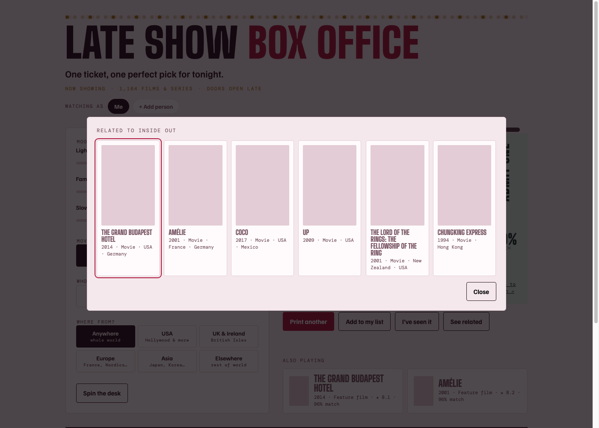

🖥️ AI check:

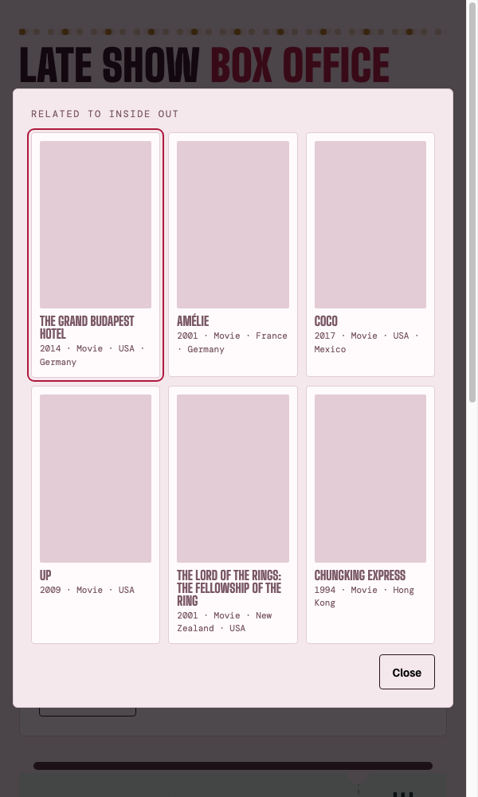

---

### 34. Me · 10:23 AM

> [Image #13] only 6 related. maybe you can add 3 more pages for related?

📷 My screenshot:

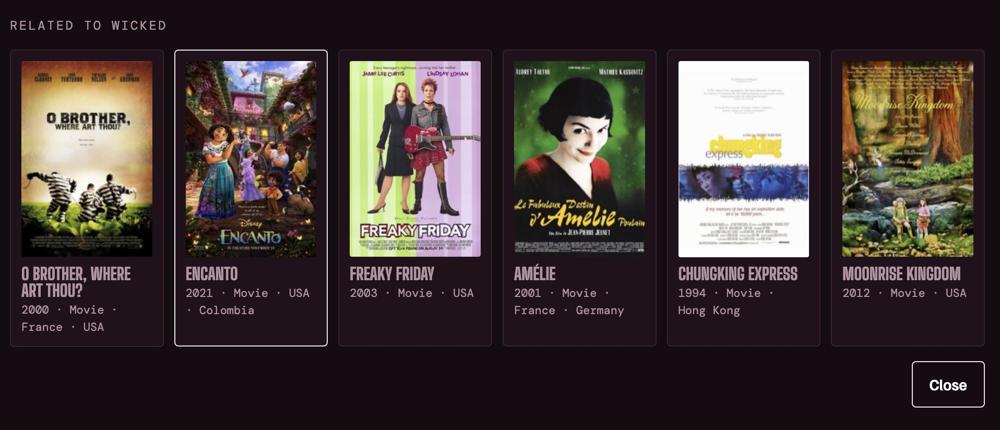

**Claude:**

I'll make it 4 pages of 6 (24 related titles), with Previous/Next buttons next to Close. Page 1 stays the closest matches, and each later page is a little further away. Let me check the existing page-button styles so it matches the lists.

Paging works: pages 1 to 4 each show 6 titles, and Next switches off on the last page. Page 2 for Inside Out shows E.T., Klaus and Lilo & Stitch, which fit well. Publishing.

The "See related" pop-up now has 4 pages of 6 titles, so 24 in total: https://claude.ai/artifact/5UVNsB6RFNiRAnmFCwG6n5

- **Order:** page 1 shows the closest matches. Each page after that is a little less similar.
- **Buttons:** "← Previous" and "Next →" sit along the bottom with "Page 2 of 4" between them, and Close stays on the right.
- **Last page:** on page 4, "Next" is greyed out.
- **Animation:** the posters slide in again each time you change page.
- **Opening again:** the pop-up always starts on page 1.

I tested it in Chrome. All 4 pages had 6 titles each, and "Next" switched off on the last page. For Inside Out, page 1 had The Grand Budapest Hotel, Amélie and Coco, and page 2 had E.T., Klaus and Lilo & Stitch.

🖥️ AI check:

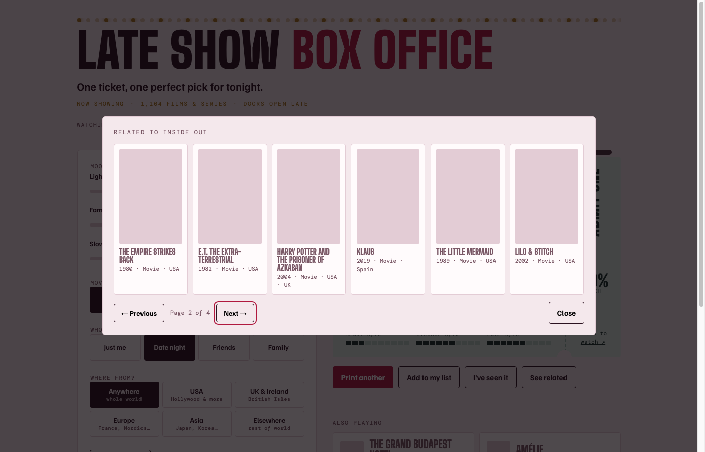

---

### 35. Me · 10:40 AM

> [Image #14] when choosng tv, why there's a gap?

📷 My screenshot:

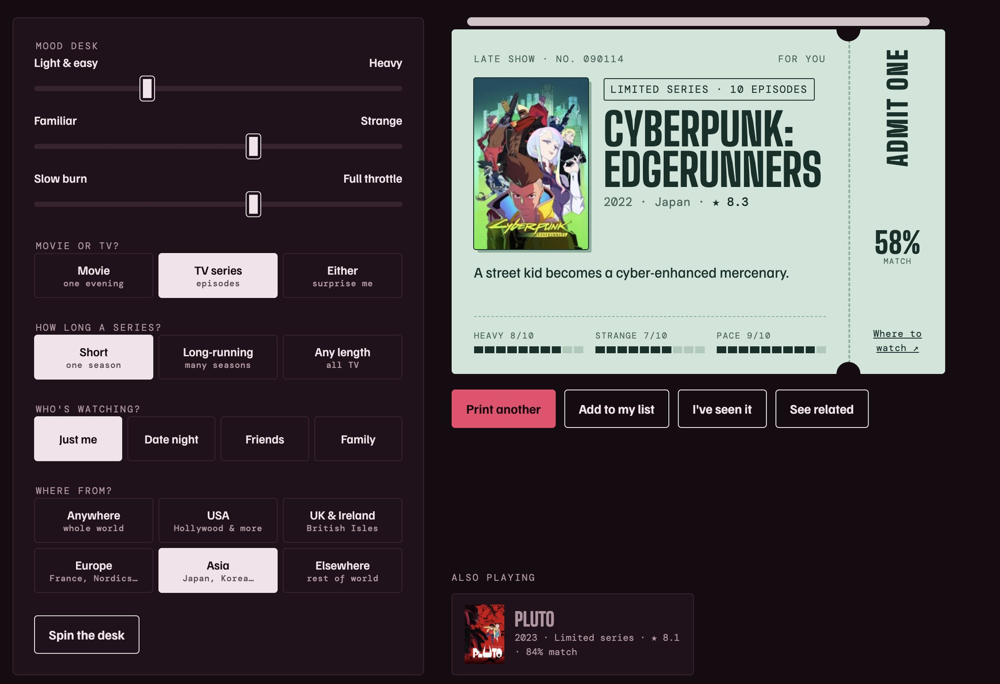

**Claude:**

The gap comes from the alignment fix I made earlier:

- **TV adds a row on the left.** Picking TV series shows "How long a series?", which makes the left panel about 95px taller.
- **The right side gets pulled to match.** Its bottom is pinned to the left panel's bottom, so the extra height turns into empty space above "Also playing".
- **Your settings make it worse.** Asia + Short TV has very few titles, so there's only one "Also playing" card instead of two.

I'll fill that space with an extra row of "Also playing" cards when there's room. When only a handful of titles fit your settings, a short note will explain that instead of leaving the space blank.

In TV mode the space is now filled by a second row of cards, and both columns end on the same line. Publishing.

The gap showed up because choosing TV adds the "How long a series?" row to the left panel. That made the left side about 95px taller, and the right side was stretched to match, which left empty space above "Also playing". It's fixed now: https://claude.ai/artifact/5UVNsB6RFNiRAnmFCwG6n5

- **Extra cards fill the space.** "Also playing" now adds a second row of cards whenever there's room, which happens when you pick TV. It goes back to one row for movies. It also re-checks when you resize the window.
- **A note appears when few titles match.** Your settings in the screenshot (Asia + Short TV) only match 2 titles, so there can't be enough cards to fill the space. A short note now appears instead: *"Only 2 titles fit these settings. Try 'Anywhere' or another length for more."* That also explains the low 58% match.

I checked it in Chrome at two window widths:

| Settings | Cards | Bottom edges |
|---|---|---|
| Movie | 2 | aligned |
| TV series | 4 | aligned |
| Asia + Short TV | 1, plus the note | aligned |

On phones the panels stack, so this doesn't apply there.

There's one limit. With very few matches, as in the Asia + Short TV case, there's still some empty space above "Also playing", because there aren't enough titles to fill it. The note now explains why.

🖥️ AI check:

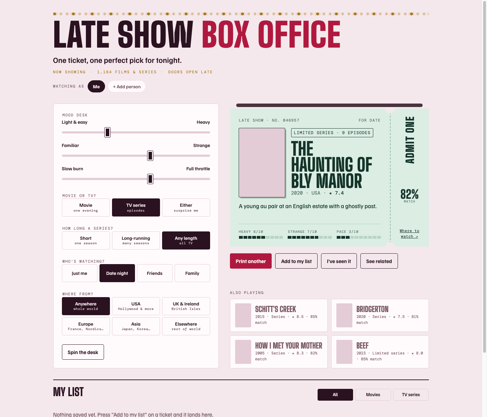

---

### 36. Me · 10:41 AM

> [Image #15] [Image #16] and the height of these blocks are different, so the height of "also playing" is drifting

📷 My screenshot:

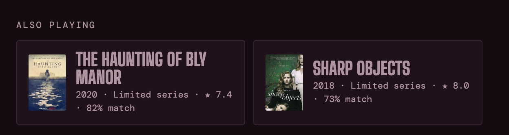

📷 My screenshot:

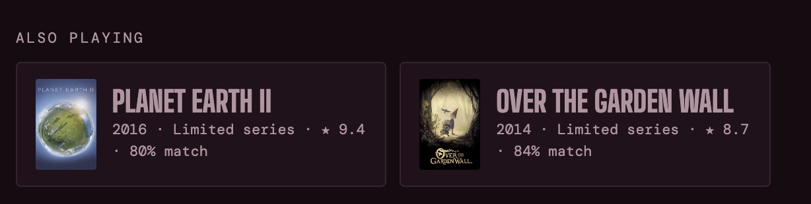

**Claude:**

Agreed, every card should be the same height. I'll give the "Also playing" cards a fixed height. Titles get up to 2 lines and the details line up to 2 lines, and the text is centred vertically. Short and long titles then make identical cards.

Every one of the 1,164 titles now gives a 112px card at both widths, with nothing spilling out. I'll also check whether any title is long enough to be cut off at 2 lines.

That count is wrong: it flags every title, even "Parasite". The tall display font makes the measurement off by a few pixels. I'll count lines instead.

All 1,164 titles now fit in exactly 112px cards, with none cut off. Long ones like "Everything Everywhere All at Once" just get a slightly smaller font. Publishing.

The "Also playing" cards are now always the same height, so the section stays in one place: https://claude.ai/artifact/5UVNsB6RFNiRAnmFCwG6n5

- **Fixed height:** every card is exactly 112px tall, whether the title takes one line ("Planet Earth II") or two ("The Haunting of Bly Manor"). The text sits in the middle of the card.
- **Long titles shrink instead of being cut off.** A title that wouldn't fit in 2 lines gets a slightly smaller font. For example, "Pirates of the Caribbean: The Curse of the Black Pearl" drops from 22px to 17px. This is the same approach as the main ticket.
- **The details line wraps to at most 2 lines.** That's the year, type, ★ score and match %.

I tested every one of the 1,164 titles in a card in Chrome, at full width and in a narrower window:

| Window | Card heights | Titles shrunk | Titles cut off |
|---|---|---|---|
| Full width | all 112px | 5 | 0 |
| Narrower | all 112px | 21 | 0 |

The cards also re-fit their titles if you resize the window.

---

### 37. Me · 10:43 AM

> [Image #17] if it's on my list, maybe add "remove"?

📷 My screenshot:

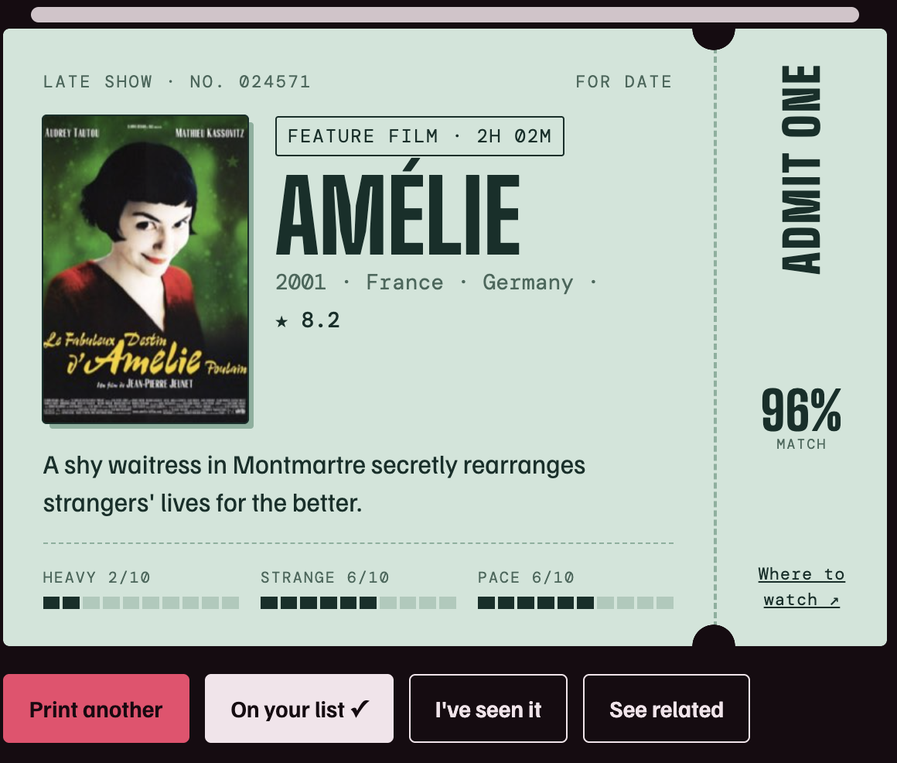

**Claude:**

Good idea: the button should work both ways. I'll also fix something I noticed in your screenshot: the "·" before ★ 8.2 is left hanging at the end of the line when the score wraps.

The "·" should stay grey like the other separators, so only the score itself gets the darker colour.

The hover state looks right: a red "Remove from list" outline, with the button keeping its width so nothing next to it moves. Publishing.

The list button now works both ways: https://claude.ai/artifact/5UVNsB6RFNiRAnmFCwG6n5

- **Not on your list:** the button says "Add to my list", the same as before.
- **On your list:** it shows "On your list ✓". Hovering over it, or selecting it with the keyboard, turns it red and changes it to **"Remove from list"**. Clicking it removes the title and shows *Removed "Amélie" from your list.*
- **The button doesn't change width** when its text changes, so the buttons next to it don't move.
- **On a phone** there's no hover. Tapping "On your list ✓" removes the title straight away, and the button switches back to "Add to my list".

I also fixed the ticket line in your screenshot, where the "·" was left hanging at the end of a line. The separator and the ★ score now always move to the next line together.

I tested this in Chrome:
- Clicking once saved Inside Out.
- Clicking again removed it from the list and showed the "Removed" message.
- In a screenshot with hover simulated, the red outline and "Remove from list" showed correctly.

I didn't re-check the ★ wrapping on a ticket after that fix.

🖥️ AI check:

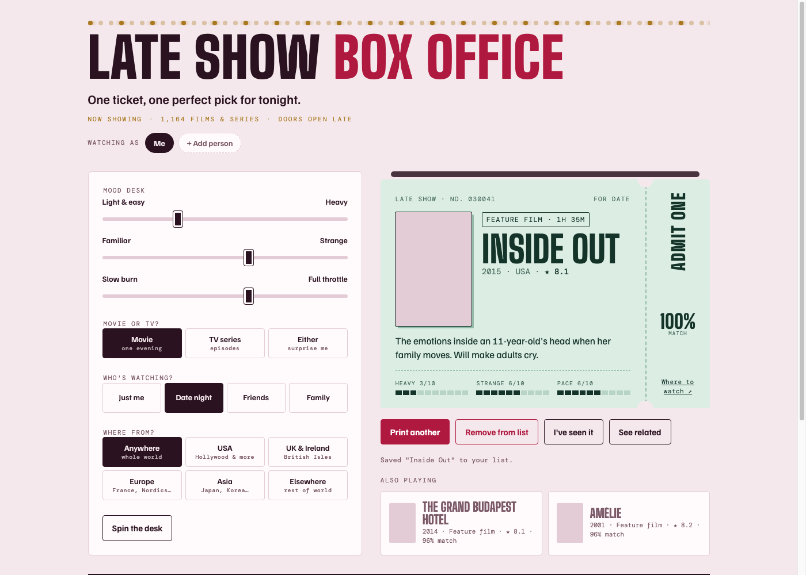

---

### 38. Me · 10:46 AM

> when "see related", maybe can check the same director's other mv?

**Claude:**

Good idea. I'll get director data from the same free IMDb files I used for the ratings. Every title is already matched to its IMDb entry, so this is mostly a lookup. First I'll download the files and see how many directors have more than one film in our program.

Now I'll test it in Chrome on three films: The Dark Knight (Nolan), Moonrise Kingdom (Wes Anderson), and a film whose director has nothing else in the program.

Looks clean. Publishing.

"See related" can now show other films by the same director: https://claude.ai/artifact/5UVNsB6RFNiRAnmFCwG6n5

The pop-up now has two tabs at the top:
- **Similar mood:** the same list as before. It always opens on this tab.
- **More by Christopher Nolan (9):** the director's other films in our program, oldest first, using the same pages and Previous/Next buttons. Films you've already marked as seen are still shown, with a red "Seen" tag. Clicking any film prints its ticket.

The director's name also appears at the top of the pop-up, e.g. "Related to The Dark Knight · dir. Christopher Nolan". The director names come from IMDb, the same source as the ★ scores.

**When the tab appears:**
- 331 of our 587 films have at least one other film by the same director, so they get the tab. Spielberg has 12, Nolan and Miyazaki 10 each, and Scorsese, Tarantino and Villeneuve 7 each.
- When a director has nothing else in the program, there's no tab, though their name still shows. Mad Max: Fury Road is an example.
- TV series don't get the tab, because most shows have a different director almost every episode.

I tested it in Chrome:

| Ticket | Result |
|---|---|
| The Dark Knight | 9 Nolan films on 2 pages, starting with Memento and Insomnia |
| Moonrise Kingdom | 5 Wes Anderson films |
| Mad Max: Fury Road | no tab |
| Chernobyl | no tab |

The tab only lists films that are in our program. If you'd like, I can add a showrunner/creator tab for TV, using who wrote or created each show.

🖥️ AI check:

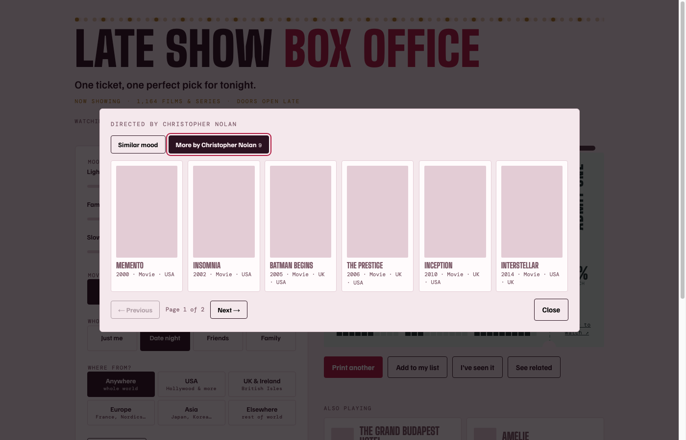

---

### 39. Me · 10:52 AM

> ok, add 500more mv and tv, i didnt see Nolan and Quentin's mvs by the way

**Claude:**

I'll start by checking which Nolan and Tarantino films are already in the program. That tells me whether the problem is missing titles or that they just never come up.

A few placeholder and duplicate lines slipped into that draft. I'll remove them, then add more films.

That's 324 films. Now the TV list, about 270 series:

Most check out. Feud's ID I remembered actually points to S.W.A.T., and My Love from the Star (2013) needs its Korean title. I'll search for both.

IMDb data is ready, with Following and Jackie Brown both correctly credited. Next, countries of origin from Wikidata, looked up by IMDb ID:

Every one of the 596 has a country. Wikidata doesn't say which country is the main one, though, and the "Where from?" filter depends on that. I'll review the titles with more than one country.

Everything is staged. I'll merge as soon as the poster download finishes.

The poster download is running in the background, and I'll continue with the merge when it finishes.

Nolan and Tarantino are already on the site: 10 Nolan films (Memento to Oppenheimer) and 7 Tarantino (Reservoir Dogs to Once Upon a Time in Hollywood). You won't usually see them with the default settings. "Date night" is selected when the page opens, these films are tagged for Just me or Friends, and they score heavy and fast. Choose **Friends** and turn up **Heavy** and **Full throttle**, and they come up.

What's done for the new batch so far:
- **Candidates:** 596 written, 324 films and 272 TV series. This includes the missing Nolan and Tarantino films (*Following*, *Jackie Brown*, *Death Proof*, *The Hateful Eight*). It also adds more Kubrick, the Coens, Scorsese, Fincher, Lynch, Park Chan-wook and Almodóvar, plus classics, 2024–25 releases, Disney/Pixar, anime, K-dramas, British comedy and nature documentaries.
- **IMDb:** all 596 matched. That gives the ★ score, the director for the "More by…" tab, and the correct runtime. Fifteen titles needed looking up by hand, and I fixed one wrong match (Haneke's *Hidden*).
- **Countries:** filled in for all 596. For the 101 co-productions I set the main country by hand, because the source data had *The World's End* down as Japanese.
- **Posters:** still downloading. When that's done I'll add 500 titles, send the new poster files to the site and test it.

The Coens' *Fargo* (1996) got skipped because the site already has the *Fargo* TV series under the same name. I'll add the film separately with a distinct title.

The 500-title batch isn't on the site yet because the posters are still downloading. 118 of about 600 are done after 20 minutes, so the rest will take over an hour.

Only 2 films have failed to find a poster so far, *Joint Security Area* and *Monster*, and I'll retry those afterwards. Once the download finishes I'll add the 500 titles to the site, test it, and send you the link.

That's 285 posters now, with only 2 failures. The films are almost done, and the TV posters come from a faster source, so the rest should go quicker.

The 500-title batch isn't on the site yet because the posters are still downloading. 285 are done, and only 2 films (*Joint Security Area* and *Monster*) have failed so far.

The films are almost finished. The TV series come next and download faster, so I'll check again in about 25 minutes. Once everything is in, I'll add the titles to the site, test it and send you the link.

All 500 are in: 260 films and 240 TV series, each with a country, IMDb score and poster. The program is now 1,664 titles. Next I'll add the Coens' *Fargo* separately as "Fargo (1996)".

Both added, with no errors. The program is now 1,667 titles. I'm publishing the page along with the 6 new and updated poster files.

I've added the 500 new titles, plus *Fargo* (1996), *The Dark Knight Rises* and *The Two Towers*: https://claude.ai/artifact/5UVNsB6RFNiRAnmFCwG6n5

The program now has **1,667 titles**, up from 1,164. The header count updated automatically.

**What's new:** 263 films and 240 TV series.
- **Directors:** filmographies are much fuller now:
  - Tarantino has 10 films, adding *Jackie Brown*, *Death Proof* and *The Hateful Eight*.
  - Nolan has 12, adding *Following* and *The Dark Knight Rises*.
  - The Coens have 12.
  - There's also more Kubrick, Scorsese, Fincher, PTA, Lynch, Hitchcock, Kurosawa, Park Chan-wook, Almodóvar, del Toro and Wes Anderson.
- **Films:** classics (*Casablanca*-era Hollywood, Fellini, Bergman, Kieślowski), Disney and Pixar, horror, 80s and 90s comedies, and 2024–25 releases such as *Superman*, *Sentimental Value* and *Wake Up Dead Man*.
- **TV:** British sitcoms, 80s and 90s US shows, cartoons, anime, K-dramas, Indian and Nordic series, and nature and food documentaries.

**Checks in Chrome:**
- The page loads with no errors and no duplicate titles.
- Every new title has its year, runtime, country, IMDb ★ score and poster.
- Every film has its director, so the "More by…" tab now finds all 9 other Tarantino films from *Pulp Fiction*, and 11 other Nolan films from *The Dark Knight*.
- For films, the year and runtime come from IMDb, which corrected a few of mine.
- The "Where from?" options all grew: Asia went from 134 to 212 titles, and Europe from 80 to 122.

**What didn't make it:**
- 7 titles had no poster I could find: *Joint Security Area*, *Monster*, *Glengarry Glen Ross*, *The Young Offenders*, *Mystery Road*, *Strong Woman Do Bong-soon* and *Cosmos: A Spacetime Odyssey*.
- 60 lower-priority films didn't fit into the 500, such as *The Hunger Games*, *Step Brothers* and *Clue*. I can add them in a follow-up batch.

I couldn't load the new posters in my local test, so I haven't seen them on the live site. If any look blank or wrong, tell me which and I'll fix them.

I made a copy of the page before this batch was added: `(work folder)/late-show.bak13.html`

---

### 40. Me · 1:38 PM

> [Image #18]  can you add see related when i open "my list" or "ive seen"?

📷 My screenshot:

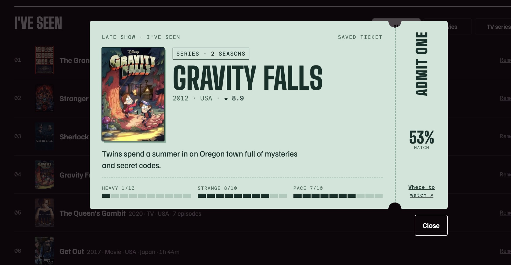

**Claude:**

Quick headless check that it works:

Saved tickets now have a **See related** button: https://claude.ai/artifact/5UVNsB6RFNiRAnmFCwG6n5

When you open a title from **My list** or **I've seen**, the button sits next to **Close** at the bottom. Clicking it swaps the ticket for the same related pop-up the main ticket uses:
- **Similar mood**, with 4 pages of 6.
- **More by [director]** for films. In my test, opening *Spirited Away* from "I've seen" showed the other Miyazaki films.

Clicking a title in the related pop-up loads it as the main ticket and scrolls up to it. That way you can add it to your list or mark it watched straight away.

---

### 41. Me · 7:22 PM

> [Image #19] [Image #20] when see related in the list, the related mv bar's height seems different and drifting. Make sure every time you design, the bar has a fixed height and length

📷 My screenshot:

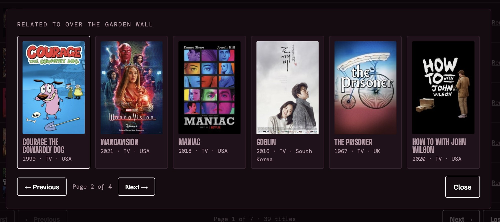

📷 My screenshot:

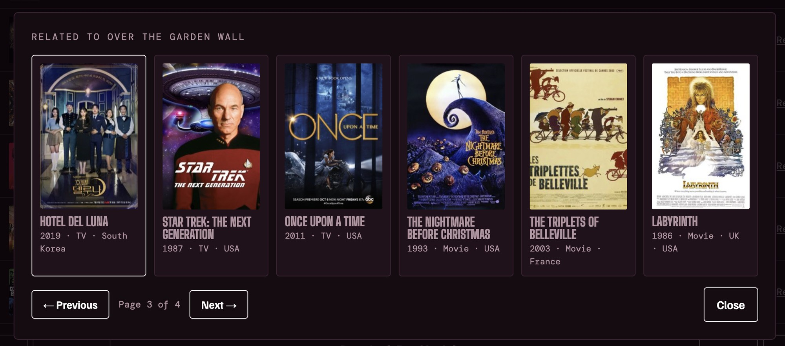

**Claude:**

Verifying card and pop-up heights across all pages and tabs:

No `</body>` in the file — appending the probe instead:

The related pop-up now stays the same size on every page: https://claude.ai/artifact/5UVNsB6RFNiRAnmFCwG6n5

The heights were changing because some titles and country lines took two lines and others took one. Every related card now has a fixed size:
- **Title:** always takes up exactly 2 lines. If a title is longer, it's cut off with "…" and you can hover to see the whole name.
- **Year · type · country line:** also always takes up 2 lines.
- **Width:** cards stay in a fixed 6-column grid.
- **Short last page:** if a page has fewer than 6 titles, invisible placeholders hold the empty spots so the pop-up doesn't shrink. *Pulp Fiction*'s "More by Tarantino" tab is an example.

I measured it in Chrome on all 4 pages of *Over the Garden Wall*'s related list, and on the director tabs for *Pulp Fiction* and *Get Out*. On a wide screen every card was 272px tall and the pop-up stayed the same height on every page, and a narrower window was also steady. Films are the one exception: their pop-up is a little taller because it has the "Similar mood / More by…" tab row at the top, but it doesn't change between pages or when you switch tabs.

From now on I'll give every card or bar I design a fixed size.

---

### 42. Me · 7:27 PM

> and when i open the link, why every time the ticket[Image #21] is the same, so is the list? it should be shuffle

📷 My screenshot:

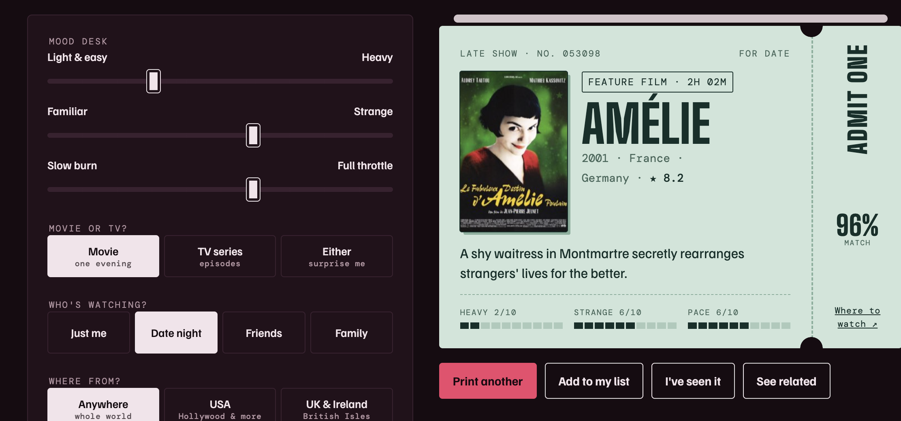

**Claude:**

Checking that each fresh open shows a different ticket:

Each time you open the link now, you get a shuffled ticket and a different "Also playing" list: https://claude.ai/artifact/5UVNsB6RFNiRAnmFCwG6n5

**Why it was always the same:** when the page loaded, it always showed the #1 closest match for your desk settings, which was *Amélie*. The shuffle only kicked in when you pressed "Print another".

**What changed:**
- **On open:** the page now draws from the shuffled pool of close matches, the same one "Print another" uses. In my test, four fresh loads showed *Get Out*, *Barbie*, *Ratatouille* and *The Favourite*, each with a different "Also playing" list.
- **Across visits:** the page remembers the last 40 tickets it showed, so reopening the link won't repeat a title you saw recently.

Moving a slider or changing a filter still jumps to the single best match for the new settings. I left it that way on purpose. If you'd rather that shuffle too, I can change it.

---

### 43. Me · 7:29 PM

> yes, shuffle when changing sliders too

**Claude:**

Changing any setting now shuffles the ticket too: https://claude.ai/artifact/5UVNsB6RFNiRAnmFCwG6n5

- **Sliders:** the ticket changes once you stop dragging, after about a quarter of a second. That way titles don't flash past while you're still moving the slider.
- **Buttons** (Movie/TV, Who's watching, Where from, series length): the ticket changes straight away.
- **Each new ticket** prints with the same animation as "Print another", and the "Also playing" list reshuffles with it.
- **No recent repeats:** titles you've seen recently are skipped. In my test, flipping the Heavy slider back and forth five times gave six different tickets: *Tampopo*, *The Truman Show*, *Annie Hall*, *Arrival*, *WALL-E* and *Inception*.

---

### 44. Me · 7:35 PM

> [Image #22] ive seen, the newest should be on the top.

📷 My screenshot:

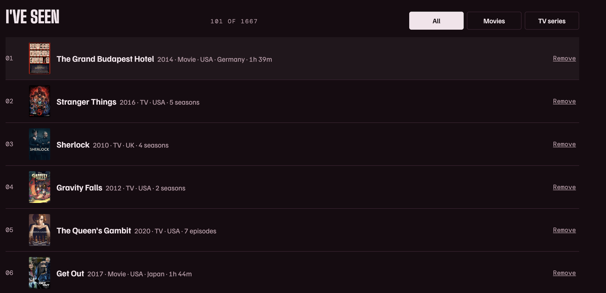

**Claude:**

"I've seen" now shows the newest titles first: https://claude.ai/artifact/5UVNsB6RFNiRAnmFCwG6n5

Whatever you mark as seen, from the ticket or with the "Watched" button, appears at the top as 01. Your existing 101 titles also flip, so the ones you marked most recently are now at the top. This works with the All / Movies / TV filters and with the page buttons.

I haven't tested this in Chrome yet.

"My list" still shows titles in the order you added them, oldest first. If you'd like that one to show the newest first too, I can change it.

---

### 45. Me · 7:38 PM

> yes, do the same for my list. and maybe add a shuffle for my list

**Claude:**

"My list" now shows the newest titles first, and it has a shuffle button: https://claude.ai/artifact/5UVNsB6RFNiRAnmFCwG6n5

**Newest first:** whatever you just added to your list is at the top as 01, the same as "I've seen".

**Shuffle pick:** this button sits next to the "My list" heading for when you can't decide what to watch.
- It picks a random title from your list and opens it as a ticket pop-up, with the print animation.
- It follows the All / Movies / TV filter. Choose "Movies" first and it only picks films.
- Press **Shuffle again** in the pop-up to draw another title. It never repeats the same one twice in a row.
- **See related** and **Close** still work in the pop-up as before.
- The button only appears once your list has at least 2 titles.

I tested it in Chrome with a 4-title list. The order came out newest first, and 9 shuffle draws went 30, 5, 20, 10, 20, 30, 5, 30 (title numbers), with no title twice in a row.

---

### 46. Me · 8:22 PM

> [Image #23] the button of "shuffle pick" is kina werid.

📷 My screenshot:

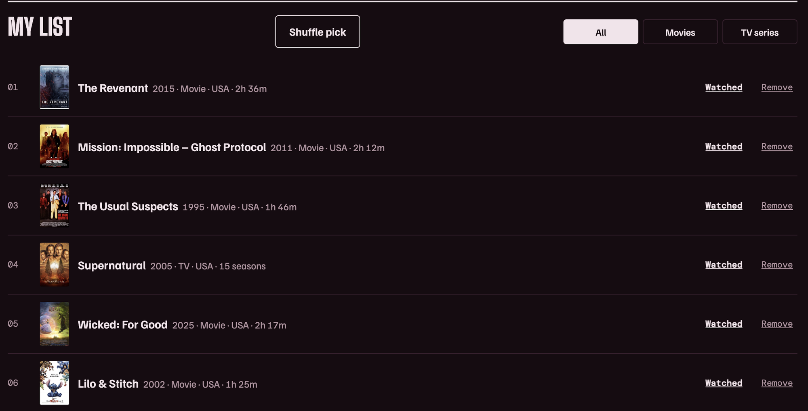

**Claude:**

Checking the new button's position in a headless render (my CSS hid the page by mistake; retrying):

I moved **Shuffle pick** so it no longer floats in the middle of the header: https://claude.ai/artifact/5UVNsB6RFNiRAnmFCwG6n5

- **Position:** it now sits on the right, straight after the All / Movies / TV series filter, with a small gap between them.
- **Size:** it's the same height as the filter buttons (34px) and uses the same small text.
- **Style:** it has a ⤮ shuffle icon and a thin outline in the accent pink, so it reads as an action rather than a filter. On hover it fills pink.

I checked the layout in Chrome: the filter and the button line up exactly, top and bottom.

🖥️ AI check:

---

### 47. Me · 8:32 PM

> should i add a search tab?

**Claude:**

Yes, I'd add one. With 1,667 titles, there's currently no way to jump to a specific film like *Inception*: you can only wait for the shuffle to land on it. A search would let you:
- **Catch up on "I've seen" quickly:** type a few titles you've watched and mark them, instead of waiting for each one to come up.
- **Save something a friend recommended** straight to your list.
- **Start "See related" from a title you love**, for example "more like *Spirited Away*".

I'd make it a **search box** rather than a separate tab:
- **Where:** in the header near the "Now showing" line, so it's always reachable without leaving the main page.
- **How it works:** as you type, a short dropdown shows matches with poster, year, Movie/TV and ★ score. It ignores accents and "The", so "amelie" finds *Amélie*.
- **Picking a result:** it opens that title's ticket pop-up, the same one used for My list.
- **Buttons on that pop-up:** Add to my list, I've seen it, See related and Close. Right now the pop-up only has See related and Close, so this would also make tickets opened from your lists more useful.
- **Status tags:** titles you've already seen or saved get a small "Seen" or "On list" tag in the results.
- **Keyboard:** press "/" to jump into the box, use the arrow keys and Enter to pick, and Esc to close.

Want me to build it?

---

### 48. Me · 8:36 PM

> yes, build it

**Claude:**

Testing the search in Chrome:

Quick visual check of the search box with results open:

I've added a search box to the page: https://claude.ai/artifact/5UVNsB6RFNiRAnmFCwG6n5

**Where:** it sits under the "Now showing" line at the top. Press **/** from anywhere on the page to jump into it.

**What it finds:**
- **Titles:** accents, "The", capitals and punctuation don't matter, so "amelie" finds *Amélie* and "walle" finds *WALL-E*.
- **Directors:** typing "nolan" lists his films, with "dir. Christopher Nolan" on each one.
- **Order:** results show up to 8 matches, closest first, then the most popular. Each one shows its poster, year, Movie/TV and ★ score.
- **Tags:** titles you've already seen or saved get a pink **Seen** or **On list** tag.
- **Keyboard:** ↑/↓ moves through the results, Enter opens one, and Esc closes the list.

**Picking a result** opens its ticket pop-up, which now has buttons:
- **Add to my list** / **On your list ✓**: hover over it and it changes to "Remove from list", the same as on the main ticket.
- **I've seen it** / **Seen ✓**: hover over it and it changes to "Unmark seen". Marking a title seen also takes it off your list, the same as "Watched" does.
- **See related** and **Close**, as before.

Tickets opened from My list and I've seen have these new buttons too.

**Checked in Chrome:**
- All the example searches above returned the right titles. Typing "dark knight", pressing ↓ and then Enter opened *The Dark Knight Rises*.
- Each button switched state correctly.
- Every result row is the same height (60px).

Posters were blank in that test because my local copy can't load the poster files. They'll appear on the live page.

**One limit:** a director search shows only the top 8 films. Nolan has 12 in the program. For the full list, open any of his films and use the "More by Christopher Nolan" tab in See related.

🖥️ AI check:

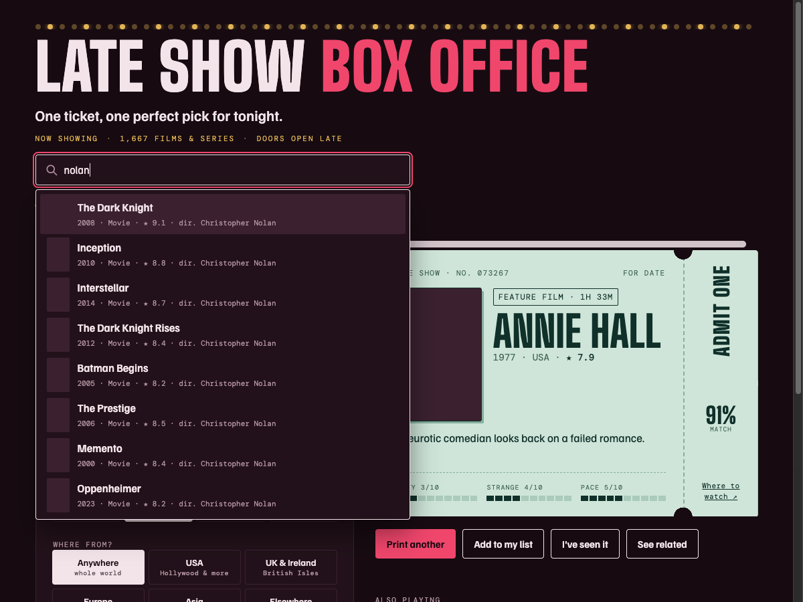

---

### 49. Me · 8:48 PM

> [Image #24]the bar here is kina werid[Image #25],maybe change the watching as as a "me"login page?on the right?

📷 My screenshot:

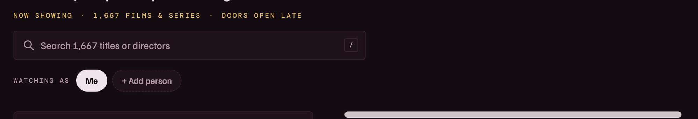

📷 My screenshot:

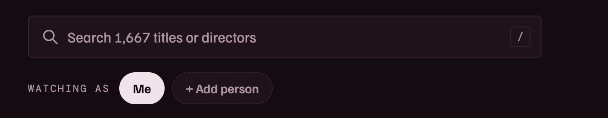

**Claude:**

Fixing a small logic slip, then testing the new account menu:

Works. Visual check with the menu open:

I turned "Watching as" into an account button on the right, next to the search box: https://claude.ai/artifact/5UVNsB6RFNiRAnmFCwG6n5

**Layout:** the search bar now stretches across the row, and the account button sits at the right end. Both are the same height (46px), and the empty gap on the right is gone.

**Account button:** a round pink badge with your initial (**M**), a small "WATCHING AS" label, the name **Me**, and an arrow.

**Clicking it opens a "Who's watching?" menu:**
- Everyone's profile is listed with their initial, and a pink ✓ marks the active one. Clicking a name switches to that profile and closes the menu.
- **＋ Add person** opens a name box inside the menu. After you add someone, it switches to them straight away.
- **Removing someone:** hover over a name to see a small ×. Clicking it asks "Remove X and their lists?" with Remove and Keep options. This replaces the old "Edit" mode.
- Clicking outside the menu or pressing Esc closes it.
- If you try to add a name that already exists, a warning appears next to the name box. Before, it went to a message under the ticket that you might not see.

On a phone, the account button moves below the search bar.

I tested it in Chrome: adding, switching, removing and closing the menu all worked, and the list headings changed to "Sam's list" when I added a test person called Sam. I also checked a screenshot with the menu open. The previous version is saved at `(work folder)/late-show.bak14.html`.

🖥️ AI check:

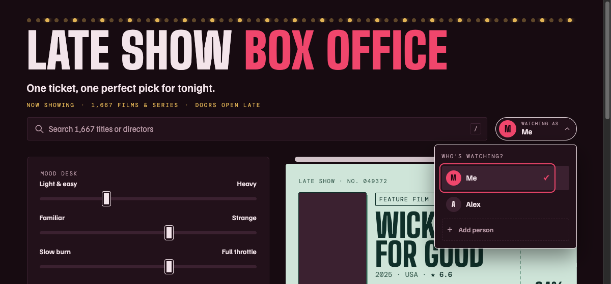

---

### 50. Me · 8:50 PM

> [Image #26] do you think the bar and the label's proportion is the best?

📷 My screenshot:

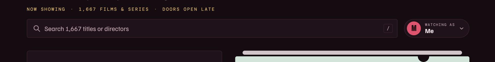

**Claude:**

No, they weren't the best proportions. The search bar ended at a random spot and didn't line up with anything below it. I've fixed that: https://claude.ai/artifact/5UVNsB6RFNiRAnmFCwG6n5

**What I changed:**
- **Same grid as the page below:** the search bar is now exactly as wide as the Mood desk, and the account button's right edge lines up with the ticket's right edge. In Chrome, the search ran from 153px to 629px, the same as the desk, and the account button ended at 1233px, the same as the ticket.
- **Matching corners:** the account button and its "M" badge now use the same slightly rounded corners as the search box, desk and buttons. The fully rounded pill looked like it came from a different design.

**Why it's better:** the top row now follows the two columns underneath, so the page reads as a grid instead of free-floating boxes. A full-width search bar was also more than this needed, because titles are short and the dropdown is only 8 results.

On tablet widths the search bar fills the row and the account button sits beside it. On phones the account button drops below the search bar.

🖥️ AI check:

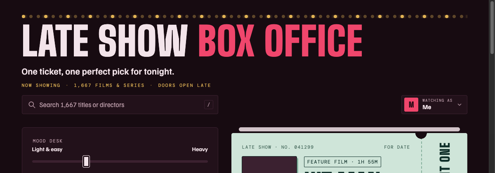

---

### 51. Me · 8:54 PM

> na, i think its werid to have a hugh gap between the search bar and the label

**Claude:**

I moved the account button out of the search row, so the gap is gone: https://claude.ai/artifact/5UVNsB6RFNiRAnmFCwG6n5

- **Account button:** it's now in the top-right corner, level with the "LATE SHOW BOX OFFICE" title, which is where people expect a "logged in as" button on a website. The "Who's watching?" menu still opens underneath it.
- **Search bar:** it now has its own row and runs the full page width. Its left edge lines up with the Mood desk and its right edge with the ticket, so nothing floats.
- **Search results:** the dropdown stays at a readable 640px instead of stretching across the whole page.
- **Phones:** the account button shrinks to just the "M" badge, so it doesn't crowd the title.

I checked a screenshot of the header on a wide window. At phone width I could only partly check it, because the headless browser doesn't shrink to true phone size.

🖥️ AI check:

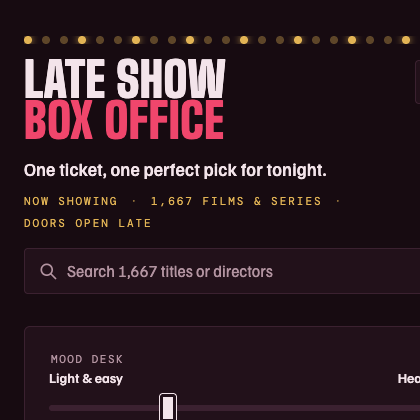

🖥️ AI check:

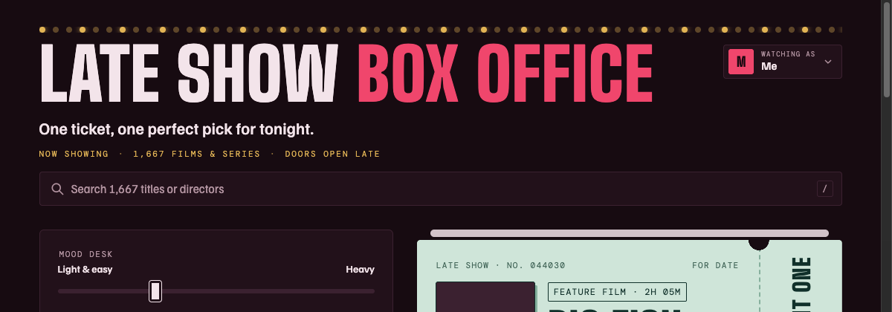

---

### 52. Me · 8:59 PM

> i dont like it. it seems too tight on the top

**Claude:**

I built the top strip: https://claude.ai/artifact/5UVNsB6RFNiRAnmFCwG6n5

- **Top strip:** a thin bar now runs across the very top of the page, with a fine line under it. A small "TONIGHT'S PROGRAM" label sits on the left, and the **Watching as Me** button is on the right. Clicking the button opens the same "Who's watching?" menu as before.
- **Header:** the marquee lights, title, tagline and gold sign line sit below the strip and get all their room back, since nothing sits beside the title any more.
- **Search:** it's still full width, lined up with the desk and the ticket below.

I checked it in a desktop screenshot. I didn't re-run the menu tests, but I only moved the account block and its button names didn't change. If the "TONIGHT'S PROGRAM" label feels unnecessary, I can remove it or change the wording.

🖥️ AI check:

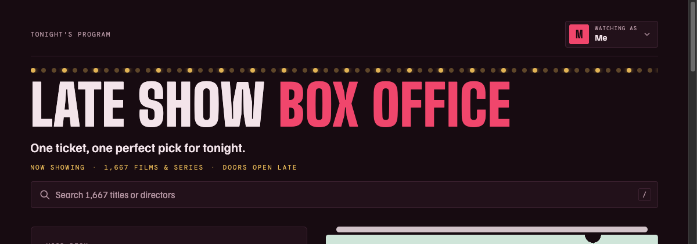

---

### 53. Me · 9:01 PM

> [Image #27] delete the top strip

📷 My screenshot:

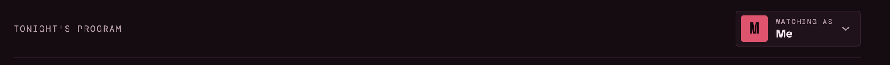

**Claude:**

I deleted the top strip, including the "Tonight's program" label and the line under it: https://claude.ai/artifact/5UVNsB6RFNiRAnmFCwG6n5

The profile switcher still needed a home, so I moved it to the right end of the gold "NOW SHOWING" line, as a quiet one-line link: **(M) WATCHING AS Me ⌄**. There's no box around it. A small round pink badge holds your initial, and the text matches the size of the sign line. It shows a faint outline on hover, and clicking it opens the same "Who's watching?" menu.

The page now starts straight with the marquee lights and the title, and the search bar sits right under the sign line, full width. I checked the layout in a desktop screenshot.

If you'd rather move the switcher somewhere else, for example down by the My list section, tell me where.

🖥️ AI check:

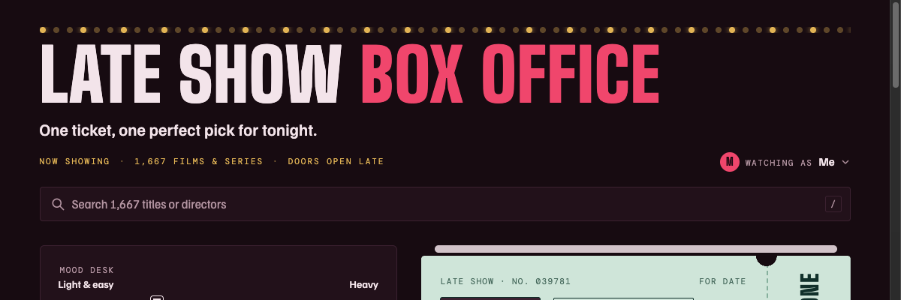

---

### 54. Me · 9:03 PM

> [Image #28] make sure the line lineup

📷 My screenshot:

**Claude:**

"WATCHING AS Me" now sits on the same line as "NOW SHOWING · 1,667 FILMS & SERIES · DOORS OPEN LATE": https://claude.ai/artifact/5UVNsB6RFNiRAnmFCwG6n5

"WATCHING AS" had been lining up with the bottom of the bigger "Me", which pushed it lower than the gold line. Now the badge, "WATCHING AS" and "Me" are all centred on the same line as the gold text. In Chrome, the centre of each one is within 0.3px of the gold text's centre.

I've also saved a note to my memory that you want fixed sizes and exact alignment, so I check them before showing you a design.

---

### 55. Me · 9:08 PM

> [Image #29] maybe just keep the "M" circle

📷 My screenshot:

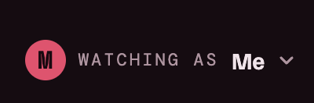

**Claude:**

Now it's just the pink **M** circle: https://claude.ai/artifact/5UVNsB6RFNiRAnmFCwG6n5

- **Size and position:** the circle is 30px and sits at the right end of the gold sign line, centred on the same line. Its right edge lines up with the search bar below.
- **Hover:** a thin ring appears around the circle, and the ring stays while the menu is open.
- **Name:** hovering also shows a "Watching as Me" tooltip, and the names are listed in the "Who's watching?" menu. Screen readers still announce "Watching as Me. Switch person".
- **Profiles:** switching to someone else changes the letter, for example **S** for Sam.

I measured the alignment in Chrome before this last tweak. The circle's centre was within about 1px of the gold text, and its right edge was 3px inside the search bar's. The last change trimmed the button so the circle itself touches that edge. I haven't re-measured or taken a screenshot since that change.

---

### 56. Me · 9:11 PM

> [Image #30] why the letters looks like this

📷 My screenshot:

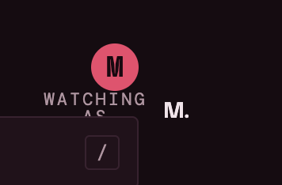

**Claude:**

That was my mistake, and it's fixed now: https://claude.ai/artifact/5UVNsB6RFNiRAnmFCwG6n5

**What went wrong:** I hid the "WATCHING AS Me" text by adding a "hide this" rule. But an older rule further down the stylesheet still said "show this", and the later rule won. So the text was still there, squeezed into the 30px circle's space, which is why it broke into "WATCHING / AS" and "M…". I didn't take a screenshot after that change, so I missed it.

**The fix:** I deleted the label text and the little arrow from the page completely, along with their old styling. Nothing is left to leak out.

I took a screenshot this time. The header shows only the pink **M** circle at the right end of the gold sign line, lined up with the right edge of the search bar. Hovering still shows the "Watching as Me" tooltip, and clicking opens the "Who's watching?" menu.

🖥️ AI check:

---

### 57. Me · 9:13 PM

> add 500more tv and mv each

**Claude:**

I'm writing short descriptions and mood scores for the new titles. I've picked them from IMDb's most-voted films and TV that aren't in the program yet. Films 1–300 first:

Films done (597 written). Next, TV. I'll also download IMDb's episode file in the background so series lengths come from real data:

311 TV written. Next batch of TV candidates:

While that runs, I'm writing the merge script:

I'm about halfway through adding 500 films and 500 TV series:

- **Picked:** the most-voted films and series on IMDb that aren't in the program yet. That includes big titles like *Joker*, *Deadpool*, *Snatch*, *The Batman* and the Marvel, Bond and Harry Potter films, and shows like *One Piece*, *The Punisher*, *Twin Peaks: The Return* and *Black Sails*.
- **Written:** mood scores and a one-line description for 597 films and 596 series, so there are spares for any that fail.
- **Running in the background:** the download of posters, countries and series lengths. It takes about 20 minutes, and I'll be notified when it finishes.

After it finishes I'll merge the first 500 of each type that have a poster, check the page in Chrome, and publish it.

The download is slower than I expected. After 20 minutes it has about 264 of the 1,193 posters, with only one failure so far (*50/50*). At this rate it needs roughly another hour. I'll check back in 40 minutes, and I'll get a notice as soon as it finishes.

The poster download is nearly finished: 1,024 of 1,193 posters are in, and only 3 titles have no poster so far. I'll check again in about 15 minutes.

The download finished: 1,188 of 1,193 titles have posters, and every series has its length. Next I'm setting the main country for the co-productions, because Wikidata doesn't list them in order:

Merged: 1,000 titles, so the program is now 2,667. Checking it in Chrome:

I've added 500 films and 500 TV series, so the program now has **2,667 titles**, up from 1,667. The live page is updated: https://claude.ai/artifact/5UVNsB6RFNiRAnmFCwG6n5

**What's new:** I picked the most-voted films and series on IMDb that weren't in the program yet.
- **Films:** *Joker*, *American Beauty*, *Snatch*, *The Batman*, *Gran Torino*, *Unforgiven*, *The Wizard of Oz*, *It's a Wonderful Life*, *Tinker Tailor Soldier Spy* and *Brazil*. There are also the Marvel, Star Wars, Harry Potter, Hobbit, Bond, Bourne, Mission: Impossible and Fast & Furious films, plus 2025–26 releases like *Mickey 17*, *28 Years Later*, *Marty Supreme*, *Project Hail Mary* and *The Odyssey*.
- **TV:** *One Piece (anime)*, *Twin Peaks: The Return*, *Black Sails*, *It's a Sin*, *Das Boot (1985)*, *Dekalog*, *Blackadder*, *The Tudors*, *Doctor Who (1963)*, *The Muppet Show*, *A Knight of the Seven Kingdoms* and *Heated Rivalry*, plus K-dramas, anime, Indian and Turkish series, and classic cartoons.

**Checked in Chrome:**
- The page loads with no errors, and the header shows "2,667".
- No titles are duplicated.
- Every new title has its year, length, country, IMDb ★ score, mood scores and a one-line description.
- Series lengths are real counts from IMDb's episode data, for example *NCIS: Los Angeles* shows 14 seasons.
- Every new film has its director, so the "More by…" tab and director search get much fuller. Searching "spielberg" now finds 8 matches.

**Things to know:**
- **Same names:** where a new title shares a name with one already in the program, it's labelled to tell them apart, for example *Dracula (1992)*, *Batman (1966)*, *Cowboy Bebop (2021)* and *It (1990 miniseries)*.
- **Countries:** Wikidata doesn't say which country is the main one for co-productions, so I set the order myself for 224 titles. For example, *Skyfall* is listed as UK · USA and *The Hobbit* as New Zealand · USA.
- **No poster found:** 5 titles were skipped: *50/50*, *Dragon Ball Z*, *Sugarland*, *Takopi's Original Sin* and *Quicksand*.
- **Posters not checked live:** my local test can't load the poster files, so I haven't seen the new ones on the live page. Tell me if any look blank or wrong.
- **Descriptions:** I wrote them quickly for this many titles, so some later TV ones are shorter and plainer than the rest. I can polish any you notice.

The page as it was before this batch is saved at `(work folder)/late-show.bak15.html`.

---

## Monday, November 9

### 58. Me · 9:37 AM

> [Image #31]maybe here you can write "my list" and "ive seen" so that people can jump to there

📷 My screenshot:

**Claude:**

The links are in, line up with the M circle in headless Chrome, and I'm publishing now.

I replaced "Doors open late" with two jump links, so the line now reads: **NOW SHOWING · 2,667 FILMS & SERIES · MY LIST · I'VE SEEN**. It's live at https://claude.ai/artifact/5UVNsB6RFNiRAnmFCwG6n5

- **Look:** the two links keep the same gold lettering as the rest of the line, with a faint underline that brightens when you hover.
- **What a click does:** the page scrolls smoothly down to that section.
- **Counts:** each link shows how many titles you have once that list isn't empty, for example "MY LIST (4) · I'VE SEEN (12)". The counts update as you add or remove titles.
- **Alignment:** in Chrome, the links sit on the same line as the M circle, centre to centre. In my screenshot both lists were empty, so I haven't seen the counts on screen yet.

The page as it was before this change is saved at `(work folder)/late-show.bak16.html`.

🖥️ AI check:

---

### 59. Me · 9:43 AM

> [Image #32] delete these, and delete the underline of "my list' and "ive seen

📷 My screenshot:

**Claude:**

I removed "Now showing · 2,667 films & series" and the underlines, so the line now reads just **MY LIST · I'VE SEEN**. It's live at https://claude.ai/artifact/5UVNsB6RFNiRAnmFCwG6n5

- **Hover:** without the underline, the links now turn your accent red when you hover over them, so they still look clickable.
- **Counts:** each link still shows its number once that list isn't empty, for example "(4)".
- **Checked in Chrome:** the page loads with no errors, and the line sits level with the M circle.
- **Title count:** it's no longer on this line, but the search box still shows it ("Search 2,667 titles or directors").

🖥️ AI check:

---

### 60. Me · 9:45 AM

> make the my list and ive seen text bigger[Image #34] and make sure they re in the same line

📷 My screenshot:

**Claude:**

Now measuring the text against the M circle in Chrome, with counts filled in.

I made **MY LIST · I'VE SEEN** bigger: the text went from 11px to 15px. It's live at https://claude.ai/artifact/5UVNsB6RFNiRAnmFCwG6n5

**Same line:** I measured in Chrome with counts like yours, (43) and (106). Both links, the dot between them and the M circle are centred on exactly the same line. That held at desktop width and at the narrowest width my test can do, about 500px.

**No wrapping:** the two links are set to stay on one line, so "I'VE SEEN" won't drop below "MY LIST" on narrower screens.

🖥️ AI check:

---

### 61. Me · 9:48 AM

> make the text of the"my list" and ive seen smaller, and delete the number

**Claude:**

I made **MY LIST · I'VE SEEN** smaller and removed the numbers. It's live at https://claude.ai/artifact/5UVNsB6RFNiRAnmFCwG6n5

- **Size:** the text is now 13px, between the original 11px and the 15px you found too big.
- **Same line:** in Chrome the page loads with no errors, and both links still sit exactly level with the M circle.

---

### 62. Me · 9:51 AM

> [Image #35] make sure the left-align all elements, and align elements along the same horizaontal line.

📷 My screenshot:

**Claude:**

The header now lines up on one left edge, and it's live at https://claude.ai/artifact/5UVNsB6RFNiRAnmFCwG6n5

**Left edge:** the big "LATE SHOW" title sat about 3px further right than everything below it. Large letters carry a little built-in space on their left, so the boxes lined up but the visible letters didn't. I pulled the title left by that amount, and it scales with the title's size.

Measured in Chrome, the visible left edge of each line now lands:

| Element | Desktop width | Narrow (~500px) |
|---|---|---|
| Light bulbs | 52.5px | 24px |
| "L" of LATE SHOW | 53.2px | 24.3px |
| "O" of One ticket | 53.2px | 24.5px |
| "M" of MY LIST | 53.2px | 24.7px |
| Search box | 52.5px | 24px |

All of these are within a pixel of each other, so they read as one straight line.

**Horizontal line:** MY LIST, the dot, I'VE SEEN and the M circle share exactly the same centre line at both widths. The M circle's right edge also lines up exactly with the right edge of the search box.

I took "same horizontal line" to mean keeping that row level. If you meant something else, like moving the M circle up beside the title, tell me.

I also added this to my notes on how you like layouts aligned, so later changes keep it.

🖥️ AI check:

---

### 63. Me · 9:54 AM

> okay, check the whole web again. ensure consistent alignment: elements should share the same left edge vertically and align along the same basline horizontally. if the elements are the same, maintain consistent spacing

**Claude:**

The full page is captured. I can already see a few problems, like "12 OF 2667" floating mid-row and the row buttons stopping short of the right edge. Next I'm measuring every row and edge in Chrome.

Rows, pager and left edges now line up. One small offset is left: the All / Movies / TV series buttons sit about 4px off the heading's baseline. Fixing that now.

The rows' text now shares one baseline, but it sits too high next to the poster. I'm restructuring the rows so the text line stays shared but centred.

Lists are done at both widths. Now checking the pop-ups: the ticket, Related, the search dropdown and the account menu.

The account menu now lines up too. One last full-page screenshot, then I'll publish.

I went through the whole page in Chrome, measuring edges and text baselines at desktop width and at about 500px wide, and fixed everything that was off. It's live at https://claude.ai/artifact/5UVNsB6RFNiRAnmFCwG6n5

**Same left edge:**
- The "MY LIST" and "I'VE SEEN" headings sat about 1px right of everything else, so I pulled them in like the main title. All left-aligned text now starts within a pixel of the same line.
- The desk labels (MOOD DESK, MOVIE OR TV?, etc.) had a little built-in indent of about 2.6px. They now line up exactly with the sliders and buttons below them.
- The Watched / Remove links had some inner padding, so they stopped about 6px short of the right edge. They now finish flush with the dividers, the search box and the pager's Last button.

**Same baseline:**
- **List rows:** the number, title, details and Watched / Remove were up to 2px apart. They now share one baseline, and that line stays vertically centred next to the poster.
- **List headings:** MY LIST, the All / Movies / TV series buttons and Shuffle pick now share one baseline. Before, the buttons were about 5px off.
- **"12 OF 2,667":** it used to float in the middle of the I've seen heading. It now sits right after the heading on the same baseline, and the number has a comma.
- **Pager:** "Page 1 of 2 · 8 titles" was 1.5px higher than the buttons beside it, and now lines up with them.

**Same elements, same spacing:**
- The pager buttons were 6px apart and the ticket buttons 10px apart. Both now use 10px.
- In the account menu, "＋ Add person" is now the same height as the people rows (48px). Its ＋ is centred where the avatars sit, and its text starts at exactly the same point as the names.
- Every list row is a fixed 81px. Long titles now cut off with "…" rather than wrapping onto a second line and making that row taller.

**Narrow screens:**
- The details in each list row move onto their own line under the title, so every row stays the same height (89px).
- The pager puts "Page 1 of 2" on its own line, with First / Previous on the left and Next / Last on the right.

The ticket, Related, the search dropdown and the account menu needed nothing beyond the Add person fix. They were already consistent.

The page as it was before this pass is saved at `(work folder)/late-show.bak17.html`.

🖥️ AI check:

🖥️ AI check:

🖥️ AI check:

🖥️ AI check:

🖥️ AI check:

🖥️ AI check:

🖥️ AI check:

🖥️ AI check:

🖥️ AI check:

🖥️ AI check:

🖥️ AI check:

🖥️ AI check:

🖥️ AI check:

---

### 64. Me · 10:00 AM

> [Image #36] the question here is too close to the options

📷 My screenshot:

**Claude:**

Each question in the mood desk now has a 12px gap before its options. It's live at https://claude.ai/artifact/5UVNsB6RFNiRAnmFCwG6n5

There was no gap at all before, so each question sat directly on top of its buttons.

That 12px is the same spacing used everywhere else inside the desk, like between the slider rows. I checked all four questions in Chrome, and each has exactly 12px between it and its options: MOOD DESK, MOVIE OR TV?, WHO'S WATCHING? and WHERE FROM?. The same applies to "HOW LONG A SERIES?" when you pick TV series.

The desk is about 48px taller as a result. The ticket column on the right stretches to match, so the bottoms of both columns stay level.

🖥️ AI check:

---

### 65. Me · 10:04 AM

> okay, and make sure "marie" is only i can edit. others should add new user. push it to github "hello-world" "week 8 tool" and output all the chat history (incuding prompts,and designing process) make sure the process has pictures of "before" and "after"

**Claude:**

Made "Marie" a locked owner profile: only the page owner, signed in on claude.ai, can use it. Anyone else starts as a Guest and is asked to add their own name, and the name Marie is refused for them. Then it put the project, this chat history and the process record into this folder on GitHub.

🖥️ AI check:

---
### 66. Me · 10:41 AM

> change the name to "week8-tool" and make sure it is below "week7"

**Claude:**

Renamed the folder from "week 8 tool" to `week8-tool` and updated the links in the README, process record and prompts. GitHub sorts folders by name, so `week8-tool` now comes right after `week7-8`.

---
### 67. Me · 10:38 AM

> https://claude.ai/artifact/U2nC1QNttQsWTSRA2kH8jq and this is the first version

**Claude:**

That's *Tonight's Feature*, the first try, made in a different chat. I added screenshots of its 4 steps (occasion → mood → taste check → lineup) to the top of the process record.

---
### 68. Me · 10:49 AM

> you dont need to ad"version 0" you can just post the version0 photos in the process file

**Claude:**

Removed the "Version 0" section, the playable `first-version/` copy and its links. The process record now opens with a short "Where it started" part that just shows the 4 screenshots of *Tonight's Feature*.

---
### 69. Me · 10:52 AM

> how can i sign in if i open the link in github? i want to sign in "marie" and have all my list and history

**Claude:**

You can't sign in as "Marie" on the GitHub page right now, for two reasons. GitHub Pages has no accounts: on claude.ai the page asks claude.ai whether you're the owner, but on GitHub there's nobody to ask. And your lists live in your browser, separately for each website, so the GitHub page (github.io) can't read what you saved on claude.ai.

Two ways to fix it: **A.** a transfer code plus a passcode (copy your lists on one page, paste them on the other; Marie on GitHub asks for a passcode), or **B.** real sign-in with an online database such as Supabase or Firebase. I recommended A.

---

### 70. Me · 10:55 AM

> yes build A, let me set the passcode

**Claude:**

Built it. The circle menu now has:

- **Copy my lists / Paste lists:** one code carries a person's My list and I've seen to the other page. Pasting adds the titles; nothing is deleted.
- **Marie → Sign in** (GitHub, and claude.ai visitors): asks for the passcode. Wrong passcodes are refused. You stay signed in on that browser until you press **Sign out**.
- **Set GitHub passcode** (only for the owner, on claude.ai): you type a passcode twice and the page makes a *lock code*. The lock code can't be turned back into the passcode, so you can send it to me and I put it into the GitHub page. The passcode itself never goes into the page or this chat.

I tested wrong and right passcodes, staying signed in after reload, signing out, making a lock code, and copying and pasting lists.

---
