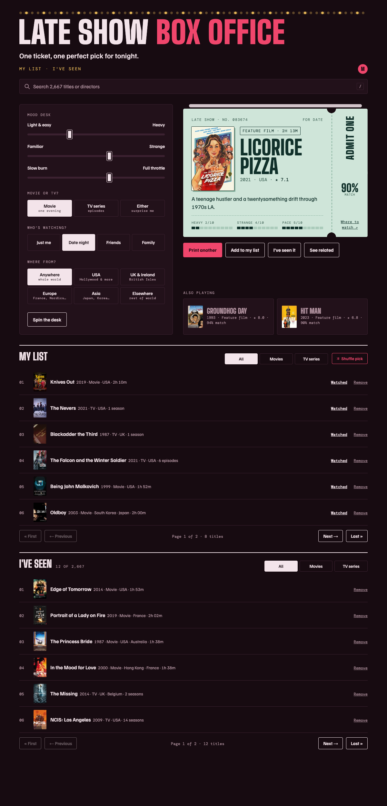

# Week 8 tool: Late Show Box Office

**What should I watch tonight?** Set your mood on a mixing desk, and the box office prints you **one ticket**: one movie or TV series, with its poster, a one-line description and how well it matches.

[▶ Open the tool](https://marie-6.github.io/hello-world/week8-tool/) · [Process record with before/after pictures](PROCESS.md) · [All 70 prompts](PROMPTS.md) · [Full chat history](CHAT_HISTORY.md)

## How to use it

1. **Mood desk:** move the sliders: light ↔ heavy, familiar ↔ strange, slow burn ↔ full throttle.
2. Choose **Movie or TV**, **Who's watching** (just me, date night, friends, family) and **Where from**.
3. Get a ticket. **Print another** for a new pick, **Add to my list** for later, **I've seen it** so it never comes back, **See related** for similar titles or more by the same director.
4. **Search** (press **/**) any of the 2,667 titles or a director.
5. Click the circle at the top right to **add your name**. Each person has their own My list and I've seen.

## What's inside

| | |
|---|---|
| Titles | 2,667 (films and TV series), each with a poster, country, IMDb ★, director (films) and 3 mood scores |
| Files | `index.html` is the whole tool. `posters/` holds the posters, 100 per file. |
| Saved data | Your lists stay in your own browser (nothing is sent anywhere). |
| Made with | Claude (Claude Code), Nov 3–9, 2026. Data from IMDb, Wikidata, TVMaze and Wikipedia. |

## Signing in as Marie and moving lists

Your lists are saved in your own browser, separately for each website. So the claude.ai page and this GitHub page don't share them.

- **Move lists between pages:** open the circle menu, press **Copy my lists**, then on the other page press **Paste lists** and paste the code. The titles are added to whoever is signed in there.
- **Marie:** on claude.ai, only the page owner can use "Marie". On GitHub, choose **Marie → Sign in** and type the passcode. **Sign out** is in the same menu.
- **The passcode** is never stored in this page. The page only keeps a scrambled "lock code" made from it, so the passcode can't be read from the code. It still only keeps out casual visitors: this is a public page with no real accounts.
